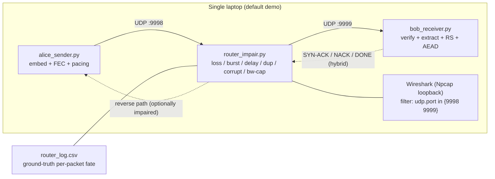
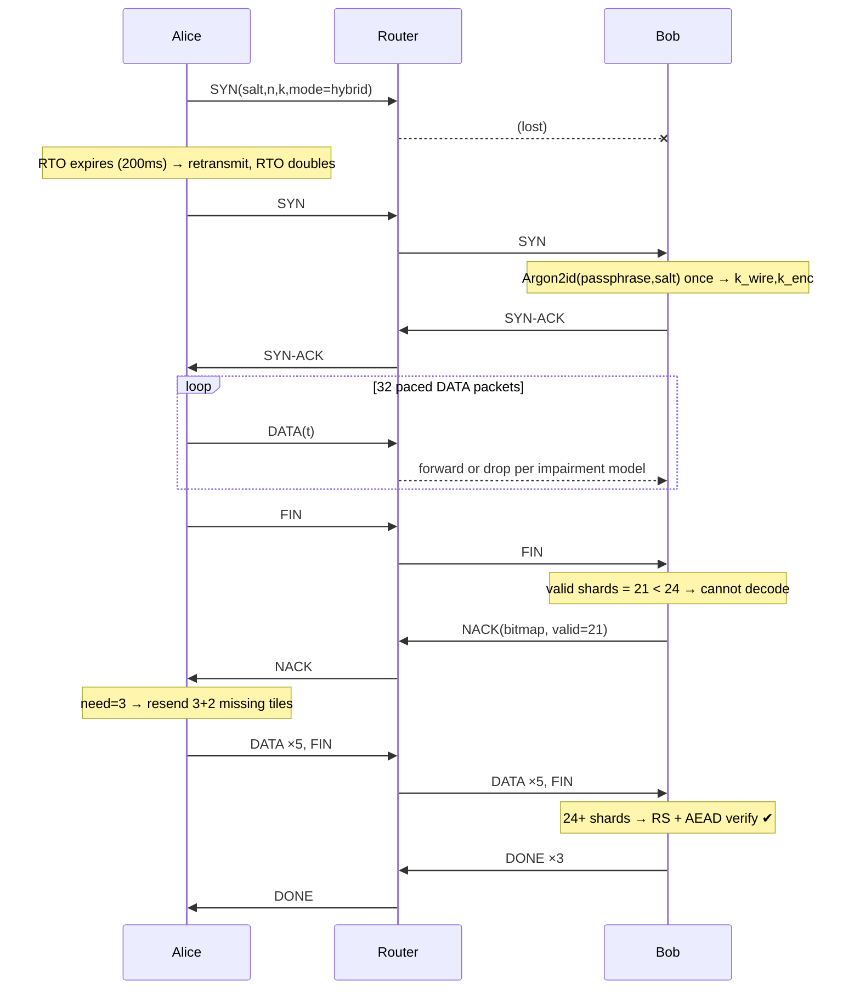
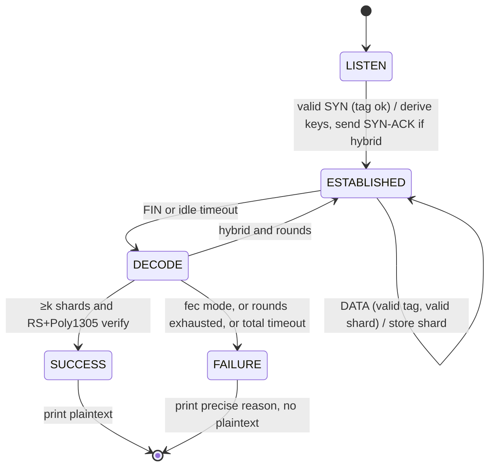

# TESSERA v3 — Upgrade Guide
### From an in-memory Streamlit simulation to a live, measurable, defensible Computer Networks + Data Privacy & Security system

> **Audience:** you (project owner), preparing for a lab/viva evaluation and an honest write-up.
> **Scope:** the Mirage steganography engine, the RS(32,24) FEC layer, the UDP wire protocol, the impaired-network testbed, Wireshark analysis, the evaluation methodology, the demo runbook.
> **Basis:** `tessera_technical_specification.md` and `master_demo_plan.md`. I have **not** run your code; every statement about your implementation is inferred from the spec and flagged where it matters. Numbers marked ✅ were computed or tested while writing this guide; numbers marked ⚠️ come from the literature or memory and must be verified before you put them in a report.

---

## Table of contents

0. [Executive summary](#0-executive-summary)
1. [Claims ledger: what you may and may not say](#1-claims-ledger)
2. [Threat model](#2-threat-model)
3. [First principles](#3-first-principles)
4. [Target architecture (v3)](#4-target-architecture-v3)
5. [Wire protocol v2 specification](#5-wire-protocol-v2)
6. [Impairment router (the real "network")](#6-impairment-router)
7. [Sender and receiver: state machines and code](#7-sender-and-receiver)
8. [FEC layer: math, capacity planning, decoding](#8-fec-layer)
9. [Crypto layer hardening](#9-crypto-layer)
10. [Stego engine upgrades](#10-stego-engine)
11. [Evaluation methodology](#11-evaluation-methodology)
12. [Wireshark: setup, filters, Lua dissector, pcap analysis](#12-wireshark)
13. [Testing strategy](#13-testing-strategy)
14. [Pitfall catalogue](#14-pitfall-catalogue)
15. [Best-practice checklist](#15-best-practices)
16. [Tradeoff register](#16-tradeoff-register)
17. [Demo runbook and viva preparation](#17-demo-runbook)
18. [Roadmap, milestones, definition of done](#18-roadmap)
19. [Scoring rubric: how to reach ~8.7/10](#19-scoring-rubric)
20. [Appendices](#20-appendices)

---

## 0. Executive summary

**What you have:** a genuinely ambitious stack — Argon2id + ChaCha20-Poly1305, a Honey-style decoy layer, a "Mirage" second layer hidden in the *sign* of ±1 pixel changes via a GF(2) wet-paper solver, systematic column-wise Reed–Solomon over 32 tiles, and a custom binary packet format.

**What is wrong with the plan (ranked by damage):**

1. **The "network" is fake.** `--drop N` makes Alice skip packets. Wireshark never sees a lost packet; an examiner will notice.
2. **The headline security claim is mis-framed.** "AUC 0.500" compares *decoy-only vs Mirage*. It says nothing about *cover vs stego*. The decoy layer itself is non-adaptive LSB matching at ~0.08–0.10 changes/pixel — detectable by SPAM/SRM-class steganalysis.
3. **The wire is not covert** (fixed magic, fixed sizes, burst of exactly 32 datagrams) yet the plan says "DPI sees normal graphics".
4. **Loss amplification is ignored.** RS tolerance is counted in *tiles*; loss happens per *frame*. On a 1500-MTU link, one 8,212-byte datagram is ~6 IP fragments.
5. **Handshake gaps:** salt/params/`n_tiles` have no defined transport; SYN/FIN are unreliable; Bob can hang.
6. **CRC32 ≠ authentication.** An injected tile with a valid CRC poisons decoding. (Mitigated below by RS errors-and-erasures — tested ✅.)
7. **Evidence is thin:** single-image statistics, no real dataset, no positive/negative controls, no confidence intervals.

**What v3 delivers** (in the order you should build it):

| Phase | Deliverable | Effort | Score impact |
|---|---|---|---|
| A | Router process with real impairment, robust handshake, Windows socket hardening, auto-generated reports, `.pcap` evidence | ~3 days | Very high |
| B | `fec` and `hybrid` (FEC + NACK) modes, failure demo that *recovers* | ~3 days | High |
| C | Keyed wire tag, optional MTU-safe fragmentation, Lua dissector | ~2 days | Medium |
| D | BOSSbase evaluation: cover vs LSBM vs Mirage, α sweep, CIs, controls | ~5 days | Very high |
| E (stretch) | Texture-aware position selection, STC-style coding | open-ended | Research-grade only |

**Correction to my earlier message ✅:** I said the practical decoy-rate floor was α≈0.14. Including binomial variance (6σ margin) and a 24-bit rank margin, a 64-byte shard needs **n_d ≥ 1,288 positions per tile → α ≥ 0.157**. To go lower you must *shrink the shard* (table in §10.2), not just reduce α.

---

## 1. Claims ledger

Every sentence in your report, slides, and viva must map to a row here. If a claim lacks evidence, it is either reworded or demoted to "design goal".

| # | Claim (as currently worded) | Verdict | Defensible rewording | Evidence you must produce |
|---|---|---|---|---|
| C1 | "Real secret is invisible; adds 0 extra pixel modifications beyond the decoy" | **True by construction** | "The second layer is carried entirely in the *direction* of changes the decoy layer already makes, so the **set of modified pixels is unchanged**." | Unit test: changed-pixel set identical for decoy-only vs Mirage (same cover, same decoy, same keys). |
| C2 | "Statistically indistinguishable (AUC 0.500)" | **Mis-framed** | "Mirage is statistically indistinguishable from *its own decoy-only embedding* (AUC ≈ 0.5, CI [..])." | Arm M vs arm L (see §11), ≥1,000 test images, CI. |
| C3 | "Existence-hiding / undetectable stego" | **False as stated** | "At change rate X the **decoy layer** is detected with P_E = Y by detector Z; Mirage adds no detectability on top." | Cover-vs-stego ROC at several α. |
| C4 | "To DPI this looks like normal graphic streaming" | **False** | "The image payload is raw pixels; the **transport framing is not covert** (identifiable by magic/size/burst). A stealth-header mode reduces, not eliminates, this." | Wireshark capture + a trivial Snort/Suricata-style rule that matches the magic. |
| C5 | "Tolerates up to 25% tile loss" | **True only for erasures at tile granularity** | "Tolerates any 8 of 32 tile losses (MDS property). Per-frame loss is amplified by fragmentation: see table in §8.3." | Empirical loss sweep vs binomial curve. |
| C6 | "Computationally infeasible to brute-force real key" | **Depends on passphrase entropy** | "Real key security = passphrase entropy × Argon2 cost. 7 EFF-wordlist words ≈ 90 bits." | Entropy table + measured Argon2 time on your laptop. |
| C7 | "Honey encryption defeats dictionary attack" | **Only for the decoy layer** | "Wrong *decoy* passwords yield plausible decoy messages. The real layer is AEAD-protected and offers an offline verification oracle, so it relies on passphrase strength." | Demo of both; threat-model table §2. |
| C8 | "100% bit-exact guarantee" | **Conditional** | "Bit-exact whenever ≥24 valid shards arrive and Poly1305 verifies; otherwise reports failure, never wrong plaintext." | Test: corrupt/inject cases never produce wrong output (§13). |
| C9 | "Survives network packet loss" | **Conditional** | "Survives ≤8 lost tiles in `fec` mode; in `hybrid` mode survives arbitrary loss given enough retransmission rounds." | Loss sweep, completion-time plot. |
| C10 | "Works over the internet / social media" | **False** | "Lossless raw/PNG pipelines only. JPEG recompression, resizing, or platform re-encoding destroys ±1 embedding." | Negative test: JPEG q=95 round-trip → extraction fails (and fails *gracefully*). |

**Rule:** any adjective ("invisible", "undetectable", "unbreakable", "100%") must be followed by a number and a condition, or deleted.

---

## 2. Threat model

State it explicitly in your report. Examiners reward clarity here more than cleverness.

### 2.1 Adversaries

| Adversary | Capabilities | Goal |
|---|---|---|
| **Eve-0 (passive network observer)** | Sees all UDP datagrams between Alice and Router/Bob. Knows the algorithm (Kerckhoffs). No keys. No cover. | Detect that a covert channel exists; read the secret. |
| **Eve-1 (steganalyst)** | Has the stego image (or reassembled stream) and a large corpus of natural images (e.g., BOSSbase). Can train detectors. No keys. | Classify *cover vs stego*. |
| **Eve-2 (coercer / dictionary attacker)** | Has the stego image, knows the scheme, can try passphrases offline, can compel Alice to reveal *a* password. | Extract a message; decide whether a second layer exists. |
| **Mallory (active network attacker)** | Can drop, delay, duplicate, reorder, corrupt, **inject** datagrams. May know protocol structure. | Break reconstruction (DoS), cause wrong output, or learn something from Bob's reactions. |
| **Warden (traffic-policy appliance)** | DPI with signatures + volumetric anomaly detection. | Block unknown/suspicious flows. |

### 2.2 What each layer defends

| Layer | Eve-0 | Eve-1 | Eve-2 | Mallory | Warden |
|---|---|---|---|---|---|
| ChaCha20-Poly1305 (real layer) | ✔ confidentiality | ✔ | ✔ if passphrase strong | ✔ integrity (reject, not recover) | n/a |
| Honey decoy (LSB layer) | partial | ✘ (detectable rate) | ✔ plausible fake | n/a | n/a |
| Mirage sign-channel | ✔ no extra footprint | ✔ no *extra* footprint vs decoy | ✔ deniable *existence of 2nd layer* | n/a | n/a |
| RS(32,24) | n/a | n/a | n/a | ✔ erasure + limited error tolerance | ✘ (fixed structure) |
| Keyed wire tag | n/a | n/a | n/a | ✔ rejects injected/modified packets | ✘ |
| Plain header (default) | ✘ fingerprint | n/a | n/a | ✘ spoofable without tag | ✘ |
| Stealth header (optional) | ◐ reduced fingerprint | n/a | n/a | ✔ with tag | ◐ |

### 2.3 Explicit non-goals (say these out loud in the viva)

* No protection against an adversary who has **the original cover image** (a cover-stego diff reveals every changed pixel).
* No robustness to lossy re-encoding.
* No anonymity (IP addresses visible).
* No forward secrecy (single-passphrase symmetric scheme).
* No protection against a **rubber-hose** adversary who demands the real passphrase.
* Traffic-analysis resistance is out of scope.

---

## 3. First principles

These are the ideas you should be able to re-derive on a whiteboard. Every design decision later references them.

### P1 — The steganographic triangle: capacity × security × robustness

You can maximize at most two. Your design picks **capacity + (conditional) security** and gives up **robustness** (no JPEG survival). Within that choice, every ±1 change costs security; every bit of payload costs changes. The *embedding efficiency* (bits carried per change) is the lever. Plain LSB matching ≈ 2 bits per change at full rate; syndrome-trellis codes (STC) with adaptive costs do far better on *where* changes land, which matters more than how many.

### P2 — Kerckhoffs's principle

Assume Eve knows everything except the keys. Consequences:

* Any property that depends on the algorithm being secret (e.g., "nobody knows the packet magic") is not security.
* The decoy position key `kd` is derived from a **deliberately weak** password; assume Eve recovers it. Your design must remain sound then — and it does *only because* the real content is protected by `kh`/`kenc` from the strong passphrase.

### P3 — Evidence conservation (the actual novelty of Mirage)

An adversary who forces a password out of Alice learns the *decoy* layer. For deniability, the stego image must carry **no additional evidence** of a second layer. In your scheme the evidence of embedding is the **set of modified pixels** (and their LSB parity). The second layer lives in a *free variable*: the direction of each change (+1 vs −1), which is otherwise a pure coin-flip in LSB matching. If the real shard bits are pseudorandom (whitened) and H₂ is secret, the sign vector is uniform over an affine subspace, i.e., statistically identical to coin flips. **This is the one claim you can defend rigorously.**

### P4 — The sign-channel lemma

For a pixel value `v` that must change parity, both `v−1` and `v+1` have the same LSB (opposite to `v`), but they differ in **bit 2 (the second-lowest bit)**: `bit2(v−1) ≠ bit2(v+1)` (they differ by 2, which flips bit 1). Careful with indexing in code: define `g(v) = (v >> 1) & 1` and test `g(v−1) != g(v+1)` explicitly for every v ∈ [1,254] in a unit test. Boundary values 0 and 255 have only one legal direction → "wet" positions.

### P5 — Wet-paper coding (Fridrich et al., 2005 ⚠️)

When the encoder has constraints the decoder doesn't know (which pixels are wet), you can still communicate if encoder solves `H_dry · d = m ⊕ H_wet · w` over GF(2) and the decoder simply computes `H · b`. Solvability needs `rank(H_dry) = r` (number of message bits). For a random r × N_dry matrix, full row rank probability ≈ `1 − 2^{−(N_dry − r)}·c`, so a margin δ ≈ 24 gives failure ≈ 10⁻⁷ per tile. Margin must also cover the *variance* of N_dry (see §10.2).

### P6 — MDS erasure coding

Reed–Solomon (n,k) over GF(2⁸) is **maximum distance separable**: *any* k of n symbols reconstruct the data. Therefore:

* Loss **position** does not matter, only **count**. Burstiness changes the *distribution* of the count, not the decoder's ability.
* With e errors (corrupted-but-undetected symbols) and f erasures (known losses), decoding succeeds iff **2e + f ≤ n − k**. ✅ I tested this with `reedsolo`: (f=4,e=2), (f=0,e=4), (f=8,e=0) succeed; (f=5,e=2) fails as predicted.

### P7 — End-to-end argument and UDP semantics

UDP gives you: datagram boundaries, no ordering, no delivery, no congestion control, optional checksum (not authentication), and IP-layer fragmentation when payload+headers exceed path MTU. Everything else — reliability, authentication, pacing, session identity — you build. The end-to-end argument says correctness checks (Poly1305) belong at the endpoints, and lower-layer checks (CRC) are performance optimizations only.

### P8 — Integrity ≠ authenticity

CRC32 detects random corruption; it does not stop an adversary. Authenticity needs a keyed MAC. Your Poly1305 tag authenticates the *final plaintext*, which is the last line of defence; a keyed per-packet tag adds early rejection and DoS resistance.

### P9 — Entropy accounting

A passphrase's strength is its entropy, not its length or "complexity". EFF large wordlist = 12.92 bits/word. Real-layer security is `min(passphrase entropy, 256)` reduced by attacker's cost per guess (Argon2 time × memory). A famous phrase has near-zero effective entropy because attackers try it first.

### P10 — Honey encryption's honest limit

Honey encryption (Juels & Ristenpart ⚠️) works when decryption under *any* key yields a *plausible* message drawn from a distribution Eve cannot distinguish from Alice's real choices. It breaks when (a) the message space is small or non-uniform relative to Eve's prior (your grammar has ~50k messages ⚠️ check), (b) any integrity check is present (adding MAC to the decoy would reintroduce an oracle), or (c) Eve has side information ("the message should mention a meeting at 3 pm").

### P11 — Measure, then claim

A security result is a *distribution* over images, keys, and seeds. One image, one seed, one p-value is an anecdote. A test statistic's p-values should be **uniform on [0,1]** under the null; check that with a KS test across hundreds of runs.

### P12 — Fail closed, fail loud

When anything is wrong (tag mismatch, <24 shards, MAC failure), Bob prints a precise failure reason and **never** emits plaintext. A correct failure is a feature you can demo.

---

## 4. Target architecture (v3)

### 4.1 Topology



* **Alice → Router → Bob** gives Wireshark both legs. Packets seen on `:9998` but not on `:9999` are *router-induced losses*; the CSV log is the ground truth to cross-check your pcap analysis.
* **Default demo = loopback.** Optional LAN variant = phone hotspot or Ethernet cable (college Wi-Fi often has client isolation; see §14).
* **Alternative impairment tools** if you prefer not to run your own router: Linux/WSL2 `tc qdisc add dev lo root netem loss 10% delay 20ms 10ms`, or Windows *clumsy*. Your own router is better for the viva because *you can explain every line of it* and it logs ground truth.

### 4.2 Processes and responsibilities

| Process | Owns | Must never |
|---|---|---|
| `alice_sender.py` | Cover loading, crypto, FEC encode, Mirage embed, wire framing, pacing, retransmission policy | Skip a packet to "simulate" loss (that is the router's job) |
| `router_impair.py` | Impairment, ground-truth log | Parse application semantics beyond best-effort logging |
| `bob_receiver.py` | Session state, tag/CRC verification, shard extraction, RS decode, AEAD verification, reporting | Print plaintext unless Poly1305 verified |
| `analyze_pcap.py` | Offline loss/seq-gap report from the pcap | Depend on live state |
| `tessera.lua` | Wireshark dissector | Be required for the demo to work (optional polish) |
| `eval/*.py` | Steganalysis + network experiments → CSV → plots | Share random seeds between train and test |

### 4.3 Transport modes

| | `fec` (open loop) | `hybrid` (FEC + NACK) |
|---|---|---|
| Feedback channel | None (Bob never transmits) | SYN-ACK, NACK, DONE |
| Survives | ≤ n−k = 8 lost tiles | Any loss pattern, given enough rounds |
| Covertness | Better (one-way flow) | Worse (bidirectional, reactive) |
| Latency | One flight | One flight + RTT per repair round |
| Overhead | Fixed 33% parity | 33% parity + repair retransmissions |
| Failure mode | Clean "need ≥24, got X" | Gives up after `max_rounds` |
| Best use | Warden-sensitive, one-way links | Honest CN demo; viva "what if 12 drops?" |

**Principle:** FEC trades *constant bandwidth* for *zero latency*; ARQ trades *latency* for *efficiency*. Hybrid ARQ (HARQ) is how real systems (LTE, satellite links) get both. Say this sentence in the viva.

### 4.4 Directory layout

```
tessera/
├── engine/                 # existing: crypto, honey, mirage, gf2 solver, rs
│   └── ...
├── net/
│   ├── packet.py           # v2 header (below)
│   ├── fec.py              # column-wise RS(32,24) with errors+erasures decode
│   └── transport.py        # Sender / Receiver / precise_sleep / udp_socket
├── tools/
│   ├── router_impair.py
│   ├── analyze_pcap.py
│   └── tessera.lua
├── cli/
│   ├── alice_sender.py
│   └── bob_receiver.py
├── eval/
│   ├── stego_eval.py       # cover vs LSBM vs Mirage; SPAM; bootstrap CI
│   ├── net_eval.py         # loss sweep, burst sweep, completion time
│   └── plots.py
├── tests/                  # unit + property + integration + fuzz
├── configs/                # one JSON per experiment (seeds, α, shard size...)
└── results/                # CSV + PNG + .pcap, committed for reproducibility
```

### 4.5 Configuration discipline

Every run writes a `run_manifest.json`: git commit, Python and library versions, config, RNG seeds, cover hash (SHA-256), session id, salt, timestamps. **Never** write passphrases or derived keys into it.

---

## 5. Wire protocol v2

### 5.1 Header (20 bytes, big-endian, struct `!HBBIIHHI`)

| Off | Size | Field | Notes |
|---|---|---|---|
| 0 | 2 | `magic` | `0x5354` ("ST"). Fingerprint in default mode; see §5.7 for stealth |
| 2 | 1 | `ver<<4 \| flags` | v2 → high nibble `2`. flags: bit0 `KEYED` (tag is keyed BLAKE2s-32 instead of CRC32), bit1 `STEALTH` (reserved), bit2 `FRAG` |
| 3 | 1 | `type` | 1 SYN · 2 DATA · 3 ACK (unused) · 4 NACK · 5 FIN · 6 SYN-ACK · 7 DONE |
| 4 | 4 | `session` | random 32-bit, chosen by Alice |
| 8 | 4 | `seq` | monotonically increasing **per packet sent** (retransmissions get new seq); gaps on Bob's leg = loss |
| 12 | 2 | `tile` | 0 ≤ t < n; informational — **the inner shard `idx` is authoritative** |
| 14 | 2 | `frag` | fragment index within tile (0 when unfragmented) |
| 16 | 4 | `tag` | CRC32 (plain) or `BLAKE2s(key=k_wire, data=header[0:16]‖payload, digest=4)` |

> Because `seq` increases on every transmission, the receiver never confuses a repair retransmission with a duplicate, and the pcap analysis can compute loss as `|{seq sent}| − |{seq seen}|` per leg.

### 5.2 SYN body (27 bytes, `!16sBBBBBHHH`)

`salt[16] · n · k · shard_len · mode(0 fec / 1 hybrid) · frags_per_tile · width · height · ct_len`

* `salt` is **public** (it is a salt). It must be fresh per session. *Reuse of salt with the same passphrase reuses the AEAD key* — see §9.4.
* Moving `ct_len`, `n`, `k` out of every shard frame and into SYN saves 4 bytes per shard (shard payload 55 → 59 bytes) and removes a repeated structured field from the sign channel. ✅ capacity effect shown in §10.2.

### 5.3 NACK body (6 bytes, `!IBB`)

`valid_bitmap[4] · valid_count · round`. Bit *i* set ⇔ shard *i* is held and CRC-valid. Alice computes `missing = {i : bit i = 0}`, `need = max(0, k − valid_count)`, resends `need + max(2, ⌈0.3·need⌉)` missing tiles, then FIN.

### 5.4 Session rules

1. Bob accepts **the first** well-formed SYN whose keyed tag verifies and ignores later SYNs for other sessions while a session is active (prevents hijack and repeated Argon2 work).
2. A *duplicate* SYN for the **same** session means SYN-ACK was lost: resend SYN-ACK, do not re-derive keys.
3. Validation order for every datagram: `len ≥ 20` → magic/version → session match → tag → type handler. Cheap checks first.
4. Never `raise` on malformed input; count it (`bad_magic`, `bad_tag`, `bad_session`, `bad_shard`) and move on. Receivers must be **total functions on arbitrary bytes**.

### 5.5 Handshake and repair sequence



### 5.6 Receiver state machine



### 5.7 Optional stealth header (stretch; read the tradeoffs first)

Goal: remove the fixed `ST` magic and make header bytes look random.

* Mask `header[0:16]` with `SHAKE256(k_wire ‖ payload[0:16])[:16]`; the first 16 payload bytes are natural pixel data that survive transit unchanged, giving a per-packet nonce for free. Keep the 4-byte keyed tag.
* **Chicken-and-egg:** `k_wire` derives from `salt`, but the salt travels in SYN. Solutions: (a) out-of-band pre-shared `--session-code` (hex salt) — simplest, honest; (b) in-band salt as the first 16 bytes of a "random-looking" SYN and make Bob attempt unmasking of unknown datagrams — **this lets anyone force Argon2 work on Bob (DoS)**; only do (b) with strict rate limits.
* Even with masking, datagram *sizes*, *burst shape*, and *bidirectional ACK pattern* remain a fingerprint. Describe stealth mode as "removes the static signature", not "makes it covert".

### 5.8 Fragmentation (`--mtu-safe`)

* Split each 8,192-byte tile into `F` fragments of ≤ 1,200 bytes (F = 7) using `frag`, set `FRAG` flag, include `F` in SYN's `frags_per_tile`.
* Bob reassembles per tile with a per-tile deadline; an incomplete tile at FIN counts as an **erasure**.
* **Cost:** loss amplification (§8.3). Use it to *demonstrate* the phenomenon and to run on real LANs; do not make it the default.

---

## 6. Impairment router

### 6.1 Why a router process

* `--drop` in Alice is not packet loss; it is "not sending". A router inserts the loss *between* two honest endpoints, and the capture shows it.
* The router logs per-packet ground truth (`router_log.csv`: time, direction, arrival index, type, seq, tile, bytes, action). Your pcap analysis must reproduce those numbers — a built-in validation of both tools.

### 6.2 Impairment models

| Flag | Model | Parameter meaning | Notes |
|---|---|---|---|
| `--loss p` | i.i.d. Bernoulli | per-datagram drop probability | Baseline; matches the binomial analysis in §8 |
| `--drop-nth 4,9,15` | deterministic | arrival indices (1-based, forward path) | Reproducible live demo; counts SYN copies and retransmissions too |
| `--ge-gb --ge-bg --ge-loss` | Gilbert–Elliott burst loss | P(good→bad), P(bad→good), loss in bad state | Stationary P(bad) = `p_gb/(p_gb+p_bg)`; mean loss = P(bad)·`ge_loss`; mean burst length = `1/p_bg` |
| `--delay --jitter` | fixed + uniform jitter | seconds | Jitter larger than inter-packet gap ⇒ **reordering** (heap-scheduled) |
| `--dup p` | duplication | probability | Tests receiver idempotence |
| `--corrupt p` | single-bit flip in payload | probability | Keyed tag must reject; CRC mode also rejects |
| `--bw-kbps --queue-bytes` | serialization delay + tail-drop queue | link rate, buffer | **Congestion-style loss** emerges naturally; best CN talking point |
| `--rev-loss p` | reverse-path loss | for SYN-ACK/NACK/DONE | Tests control-plane robustness |
| `--seed` | RNG seed | — | Same seed ⇒ identical drop pattern |

Presets worth naming in your report: **Clean** (0%), **Lossy Wi-Fi** (`--loss 0.05 --delay 0.01 --jitter 0.01`), **Mobile fade** (GE `0.05/0.25/0.9`), **Congested uplink** (`--bw-kbps 2000 --queue-bytes 32000`), **Hostile** (`--loss 0.1 --corrupt 0.05 --dup 0.05 --jitter 0.05`).

### 6.3 Verified behaviour ✅

* Reader slower than writer: with Bob not reading during Alice's burst, **21 of 30** expected datagrams arrived (9 lost to receive-buffer overflow) on a default Linux socket. With a concurrent reader: **30 of 30**. On Windows the default buffer is also small. *This is an unintended-loss pitfall that would look like a protocol bug in the demo.*
* Seed 5, loss 10%, delay 10 ms, jitter 20 ms, 2 forced drops: delivered out of order (observed order `0,1,10,7,3,11,...`), confirming heap-based reordering works.

### 6.4 Reference implementation (tested)

```python
#!/usr/bin/env python3
"""UDP impairment router:  Alice -> [left:LPORT]  ROUTER  [right:ephemeral] -> Bob.  Replies flow back.
Impairments: iid loss, Gilbert-Elliott burst loss, drop-by-arrival-index, delay+jitter (=> reordering),
duplication, bit corruption, bandwidth cap with tail-drop queue. Logs ground truth to CSV."""
import argparse, csv, heapq, random, selectors, socket, struct, sys, time

class GilbertElliott:
    def __init__(s, p_gb, p_bg, loss_good, loss_bad, rng):
        s.p_gb, s.p_bg, s.lg, s.lb, s.rng, s.bad = p_gb, p_bg, loss_good, loss_bad, rng, False
    def drop(s):
        if s.bad:
            if s.rng.random() < s.p_bg: s.bad = False
        elif s.rng.random() < s.p_gb: s.bad = True
        return s.rng.random() < (s.lb if s.bad else s.lg)

class Path:
    """One direction's impairment pipeline."""
    def __init__(s, a, rng, name):
        s.a, s.rng, s.name, s.n = a, rng, name, 0
        s.drop_nth = set(a.drop_nth) if name == "fwd" else set()
        s.loss = a.loss if name == "fwd" else a.rev_loss
        s.ge = GilbertElliott(a.ge_gb, a.ge_bg, 0.0, a.ge_loss, rng) if (a.ge_gb > 0 and name == "fwd") else None
        s.link_free = 0.0
    def process(s, data, now):
        """-> list of (deliver_time, bytes, action)"""
        s.n += 1
        a = s.a
        if s.n in s.drop_nth:                      return [(None, data, "drop_nth")]
        if s.ge and s.ge.drop():                   return [(None, data, "drop_burst")]
        if s.loss and s.rng.random() < s.loss:     return [(None, data, "drop_iid")]
        if a.bw_kbps > 0:                          # serialization + tail-drop queue
            backlog = max(0.0, s.link_free - now) * a.bw_kbps * 1000 / 8
            if backlog + len(data) > a.queue_bytes: return [(None, data, "drop_queue")]
            start = max(now, s.link_free); s.link_free = start + len(data) * 8 / (a.bw_kbps * 1000)
            t0 = s.link_free
        else:
            t0 = now
        act = "fwd"
        if a.corrupt and s.rng.random() < a.corrupt and len(data) > 20:
            b = bytearray(data); i = s.rng.randrange(20, len(b)); b[i] ^= 1 << s.rng.randrange(8)
            data, act = bytes(b), "corrupt"
        out = [(t0 + a.delay + s.rng.uniform(0, a.jitter), data, act)]
        if a.dup and s.rng.random() < a.dup:
            out.append((t0 + a.delay + s.rng.uniform(0, a.jitter), data, "dup"))
        return out

def main():
    p = argparse.ArgumentParser()
    p.add_argument("--listen", type=int, default=9998); p.add_argument("--to", default="127.0.0.1:9999")
    p.add_argument("--loss", type=float, default=0); p.add_argument("--rev-loss", type=float, default=0)
    p.add_argument("--drop-nth", type=lambda s: [int(x) for x in s.split(",") if x], default=[])
    p.add_argument("--ge-gb", type=float, default=0, help="P(good->bad)"); p.add_argument("--ge-bg", type=float, default=0.3)
    p.add_argument("--ge-loss", type=float, default=0.9, help="loss prob in bad state")
    p.add_argument("--delay", type=float, default=0); p.add_argument("--jitter", type=float, default=0)
    p.add_argument("--dup", type=float, default=0); p.add_argument("--corrupt", type=float, default=0)
    p.add_argument("--bw-kbps", type=float, default=0); p.add_argument("--queue-bytes", type=int, default=64000)
    p.add_argument("--seed", type=int, default=1); p.add_argument("--log", default="router_log.csv")
    p.add_argument("--duration", type=float, default=0, help="auto-exit after N s (0 = run forever)")
    a = p.parse_args()
    rng = random.Random(a.seed)
    host, port = a.to.split(":"); bob = (host, int(port))
    left = socket.socket(socket.AF_INET, socket.SOCK_DGRAM); left.bind(("127.0.0.1", a.listen))
    right = socket.socket(socket.AF_INET, socket.SOCK_DGRAM); right.bind(("127.0.0.1", 0))
    for s in (left, right):
        s.setsockopt(socket.SOL_SOCKET, socket.SO_RCVBUF, 4 << 20); s.setblocking(False)
    sel = selectors.DefaultSelector(); sel.register(left, selectors.EVENT_READ, "L"); sel.register(right, selectors.EVENT_READ, "R")
    fwd, rev = Path(a, rng, "fwd"), Path(a, rng, "rev")
    heap, tie, alice, t_start = [], 0, None, time.perf_counter()
    f = open(a.log, "w", newline=""); w = csv.writer(f); w.writerow(["t", "dir", "n", "type", "seq", "tile", "bytes", "action"])
    def log(d, path, data, act, now):
        typ = seq = tile = ""
        if len(data) >= 20 and data[:2] == b"ST":
            typ, seq, tile = data[3], struct.unpack("!I", data[8:12])[0], struct.unpack("!H", data[12:14])[0]
        w.writerow([f"{now - t_start:.6f}", d, path.n, typ, seq, tile, len(data), act])
    while True:
        now = time.perf_counter()
        if a.duration and now - t_start > a.duration: break
        while heap and heap[0][0] <= now:
            _, _, sock, dst, data = heapq.heappop(heap); sock.sendto(data, dst)
        timeout = max(0.0, heap[0][0] - now) if heap else 0.05
        for key, _ in sel.select(timeout):
            try: data, src = key.fileobj.recvfrom(65535)
            except ConnectionResetError: continue          # Windows: ICMP port-unreachable surfaces here
            now = time.perf_counter()
            if key.data == "L": alice, path, sock, dst, d = src, fwd, right, bob, "A>B"
            else:
                if alice is None: continue
                path, sock, dst, d = rev, left, alice, "B>A"
            for t, pkt, act in path.process(data, now):
                log(d, path, pkt, act, now)
                if t is not None: tie += 1; heapq.heappush(heap, (t, tie, sock, dst, pkt))
    f.close()

if __name__ == "__main__":
    main()
```

### 6.5 Router design notes

* `selectors` + a min-heap gives per-packet release times without threads; reordering emerges when jitter exceeds spacing.
* Learn Alice's address from the first left-socket packet; forward Bob's replies to it. The router therefore also works with **Alice and Bob on different machines** (bind `0.0.0.0`, point `--to` at Bob's LAN IP).
* Catch `ConnectionResetError` around `recvfrom` — on Windows an ICMP port-unreachable from a closed peer surfaces as WinError 10054 on the *next* receive.
* Use `time.perf_counter()` (monotonic, high resolution), never `time.time()`, for scheduling.

---

## 7. Sender and receiver

### 7.1 Design rules

1. **Separate the transport from the engine.** `transport.py` knows tiles, shards-as-opaque-bytes, and RS; it receives `extract(tile_bytes, tile_idx) -> (idx, body) | None` and `decode(shards) -> plaintext` as injected callables. This let me test the whole protocol with stubs ✅ before touching Mirage. Do the same: your Mirage embed/extract plugs into those two hooks.
2. **Pace the sender** (`--pps`, default 400–800). A burst of 32 × 8 KB is 262 KB in microseconds; pacing prevents buffer overflow and looks less anomalous.
3. **Read concurrently.** Bob's receive loop must do *only* socket I/O + cheap validation; heavy work (extraction, RS) happens *after* FIN/idle, or in a worker thread.
4. **Fail closed.** `decode` raises on Poly1305 failure; Bob prints the reason and returns no plaintext.
5. **Derive keys once per session** (Argon2 is intentionally expensive).

### 7.2 Hook mapping (stub → real)

| Reference test stub | Real implementation |
|---|---|
| `make_tiles()` fills first 64 bytes of each tile with the shard frame, rest random | `tiles[t] = mirage_embed(cover_tile_t, decoy_seed_t, shard_frame_t, kd, kh, t)` |
| `extract(tile, t)` = `parse_frame(tile[:64])` | `frame = mirage_extract(tile, kd, kh, t)` → `fec.parse_frame(frame)` |
| `kdf(salt)` = Argon2id(19 MiB, t=2) | Same function, production parameters from §9.3 |
| AEAD block padding to fixed length | Same — **fixed ciphertext length hides plaintext length** |

### 7.3 Reference code (tested)

**`packet.py`**

```python
"""TESSERA wire protocol v2: 20-byte header + payload. Tag = CRC32 (plain) or keyed BLAKE2s-32 (secure)."""
import hashlib, hmac, struct, zlib

MAGIC, VER = 0x5354, 2
SYN, DATA, ACK, NACK, FIN, SYN_ACK, DONE = 1, 2, 3, 4, 5, 6, 7
F_KEYED, F_STEALTH, F_FRAG = 1, 2, 4

HDR = struct.Struct("!HBBIIHHI")             # magic, ver<<4|flags, type, session, seq, tile, frag, tag
HLEN = HDR.size                              # 20
SYN_BODY = struct.Struct("!16sBBBBBHHH")     # salt,n,k,shard_len,mode,frags_per_tile,width,height,ct_len
NACK_BODY = struct.Struct("!IBB")            # valid-tile bitmap, valid_count, round


def _tag(key, head16: bytes, payload: bytes) -> int:
    if key is None:
        return zlib.crc32(head16 + payload) & 0xFFFFFFFF
    return int.from_bytes(hashlib.blake2s(head16 + payload, key=key, digest_size=4).digest(), "big")


def pack(typ, session, seq, tile=0, frag=0, payload=b"", key=None) -> bytes:
    flags = F_KEYED if key else 0
    head = HDR.pack(MAGIC, (VER << 4) | flags, typ, session, seq, tile, frag, 0)[:16]
    return head + _tag(key, head, payload).to_bytes(4, "big") + payload


def unpack(buf: bytes, key=None):
    """Returns dict or None. ok=None means 'keyed packet, key not supplied yet' (used for SYN)."""
    if len(buf) < HLEN:
        return None
    magic, vf, typ, sess, seq, tile, frag, tag = HDR.unpack(buf[:HLEN])
    if magic != MAGIC or (vf >> 4) != VER:
        return None
    flags, payload = vf & 15, buf[HLEN:]
    if flags & F_KEYED and key is None:
        ok = None
    else:
        ok = hmac.compare_digest(_tag(key if flags & F_KEYED else None, buf[:16], payload).to_bytes(4, "big"), buf[16:20])
    return dict(type=typ, flags=flags, session=sess, seq=seq, tile=tile, frag=frag, payload=payload, ok=ok, raw=buf)


def verify(pkt: dict, key) -> bool:
    return hmac.compare_digest(_tag(key, pkt["raw"][:16], pkt["payload"]).to_bytes(4, "big"), pkt["raw"][16:20])
```

**`fec.py`**

```python
"""Column-wise systematic RS(32,24) over GF(256). Shard frame = idx(1) | body(P) | crc32(idx||body)(4)."""
import os, struct, zlib
from reedsolo import RSCodec, ReedSolomonError

N, K, NSYM = 32, 24, 8
_rs = RSCodec(NSYM)

def frame(idx: int, body: bytes) -> bytes:
    return bytes([idx]) + body + zlib.crc32(bytes([idx]) + body).to_bytes(4, "big")

def parse_frame(fr: bytes):
    """-> (idx, body) or None if CRC fails. CRC here is only an *erasure detector*."""
    if len(fr) < 6 or zlib.crc32(fr[:-4]) != int.from_bytes(fr[-4:], "big"): return None
    return fr[0], fr[1:-4]

def encode(ciphertext: bytes, P: int) -> list:
    assert len(ciphertext) == K * P
    data = [ciphertext[i * P:(i + 1) * P] for i in range(K)]
    cols = [_rs.encode(bytes(d[c] for d in data)) for c in range(P)]          # each: 24 data + 8 parity
    shards = [bytes(cols[c][i] for c in range(P)) for i in range(N)]
    return [frame(i, shards[i]) for i in range(N)]

def decode(received: dict, P: int) -> bytes:
    """received: idx -> body (CRC-validated). Corrects erasures AND residual errors while 2e+f <= 8."""
    if len(received) < K: raise ValueError("fewer than K shards")
    miss = [i for i in range(N) if i not in received]
    out = [bytearray(P) for _ in range(K)]
    for c in range(P):
        cw = bytearray(N)
        for i, b in received.items(): cw[i] = b[c]
        dec = _rs.decode(bytes(cw), erase_pos=miss)[0]
        for i in range(K): out[i][c] = dec[i]
    return b"".join(bytes(x) for x in out)
```

**`transport.py`**

```python
"""Reference transport: Sender/Receiver with fec and hybrid (FEC + NACK) modes. Engine hooks are injected."""
import math, os, random, socket, struct, time
import packet as pk
from packet import SYN, DATA, NACK, FIN, SYN_ACK, DONE

def precise_sleep(dt):
    """Windows time.sleep() granularity is ~15.6 ms: sleep coarse, then spin."""
    end = time.perf_counter() + dt
    while (rem := end - time.perf_counter()) > 0:
        if rem > 0.003: time.sleep(rem - 0.002)

def udp_socket(bind=None, rcvbuf=4 << 20):
    s = socket.socket(socket.AF_INET, socket.SOCK_DGRAM)
    s.setsockopt(socket.SOL_SOCKET, socket.SO_RCVBUF, rcvbuf)
    if bind: s.bind(bind)
    return s

class Sender:
    def __init__(self, dst, tiles, wire_key, salt, *, n=32, k=24, shard_len=64, ct_len=0, mode="hybrid",
                 pps=500, rto=0.2, max_rounds=8, size=(512, 512), log=print):
        self.dst, self.tiles, self.key, self.salt = dst, tiles, wire_key, salt
        self.n, self.k, self.sl, self.ct_len, self.mode = n, k, shard_len, ct_len, mode
        self.gap, self.rto0, self.max_rounds, self.size, self.log = 1 / pps, rto, max_rounds, size, log
        self.sess, self.seq, self.sock, self.sent_data = random.getrandbits(32), 0, udp_socket(("127.0.0.1", 0)), 0
    def _tx(self, typ, tile=0, payload=b""):
        self.seq += 1
        self.sock.sendto(pk.pack(typ, self.sess, self.seq, tile, 0, payload, self.key), self.dst)
    def _rx(self, timeout):
        self.sock.settimeout(timeout)
        try: d, _ = self.sock.recvfrom(65535)
        except (socket.timeout, ConnectionResetError): return None
        p = pk.unpack(d, self.key)
        return p if p and p["ok"] and p["session"] == self.sess else None
    def run(self):
        body = pk.SYN_BODY.pack(self.salt, self.n, self.k, self.sl, 1 if self.mode == "hybrid" else 0, 1,
                                self.size[0], self.size[1], self.ct_len)
        if self.mode == "hybrid":                                  # SYN / SYN-ACK with exponential backoff (RFC 6298 style)
            rto = self.rto0
            for attempt in range(6):
                self._tx(SYN, payload=body); t_end = time.perf_counter() + rto
                while (rem := t_end - time.perf_counter()) > 0:
                    p = self._rx(rem)
                    if p and p["type"] == SYN_ACK: break
                else: rto *= 2; continue
                break
            else: return "handshake_failed"
        else:
            for _ in range(3): self._tx(SYN, payload=body); precise_sleep(0.01)   # open loop: redundancy instead of ACK
        nxt = time.perf_counter()
        for t in range(self.n):                                     # paced first flight
            precise_sleep(max(0, nxt - time.perf_counter())); self._tx(DATA, t, self.tiles[t]); self.sent_data += 1; nxt += self.gap
        for _ in range(2): self._tx(FIN); precise_sleep(0.01)
        if self.mode != "hybrid": return "sent"
        deadline_rounds = 0
        while deadline_rounds < self.max_rounds:
            p = self._rx(self.rto0 * 4)
            if p is None:                                           # silence: re-poke with FIN
                self._tx(FIN); deadline_rounds += 1; continue
            if p["type"] == DONE: return f"done_after_{self.sent_data}_data_pkts"
            if p["type"] == NACK:
                bitmap, valid, _rnd = pk.NACK_BODY.unpack(p["payload"][:pk.NACK_BODY.size])
                missing = [t for t in range(self.n) if not bitmap >> t & 1]
                need = max(0, self.k - valid)
                send = missing[: min(len(missing), need + max(2, math.ceil(0.3 * need)))]   # margin vs. repeat loss
                nxt = time.perf_counter()
                for t in send:
                    precise_sleep(max(0, nxt - time.perf_counter())); self._tx(DATA, t, self.tiles[t]); self.sent_data += 1; nxt += self.gap
                self._tx(FIN); deadline_rounds += 1
        return "gave_up"

class Receiver:
    def __init__(self, port, derive_key, extract, decode, *, idle=0.4, total_timeout=20, max_nacks=8, log=print):
        self.sock = udp_socket(("127.0.0.1", port)); self.derive_key, self.extract, self.decode = derive_key, extract, decode
        self.idle, self.total, self.max_nacks, self.log = idle, total_timeout, max_nacks, log
        self.stats = dict(rx=0, bad_tag=0, bad_syn=0, bad_shard=0, dup=0, nacks=0)
    def _tx(self, typ, payload=b""):
        self.seq += 1; self.sock.sendto(pk.pack(typ, self.sess, self.seq, 0, 0, payload, self.key), self.peer)
    def run(self):
        self.sess = self.key = self.peer = None; self.seq = 0; shards = {}; last_derive = -1e9
        last_rx, t0, mode_hybrid, rounds = time.perf_counter(), time.perf_counter(), False, 0
        while time.perf_counter() - t0 < self.total:
            self.sock.settimeout(0.05)
            try: d, addr = self.sock.recvfrom(65535)
            except socket.timeout: d = None
            except ConnectionResetError: continue                  # Windows UDP WSAECONNRESET
            now = time.perf_counter(); trigger = False
            if d:
                p = pk.unpack(d)
                if p:
                    self.stats["rx"] += 1
                    if p["type"] == SYN and self.sess is None:     # first valid SYN only
                        if len(p["payload"]) < pk.SYN_BODY.size or now - last_derive < 0.2:
                            self.stats["bad_syn"] += 1             # malformed, or Argon2 rate limit (DoS guard)
                        else:
                            last_derive = now
                            salt, n, k, sl, hyb, frags, w, h, ctl = pk.SYN_BODY.unpack(p["payload"][:pk.SYN_BODY.size])
                            if not (1 <= k < n <= 64 and 1 <= sl <= 255): self.stats["bad_syn"] += 1
                            else:
                                key = self.derive_key(salt)
                                if pk.verify(p, key):
                                    self.sess, self.key, self.peer, mode_hybrid, self.sl, self.k = p["session"], key, addr, bool(hyb), sl, k
                                    last_rx = now
                                    if mode_hybrid: self._tx(SYN_ACK)
                                else: self.stats["bad_tag"] += 1
                    elif self.sess is not None and p["session"] == self.sess:
                        if p["type"] == SYN and mode_hybrid: self._tx(SYN_ACK)       # SYN-ACK was lost: resend
                        elif not pk.verify(p, self.key): self.stats["bad_tag"] += 1
                        elif p["type"] == DATA:
                            last_rx = now
                            r = self.extract(p["payload"], p["tile"])             # inner idx is authoritative, not wire tile_idx
                            if r is None: self.stats["bad_shard"] += 1
                            elif r[0] in shards: self.stats["dup"] += 1
                            else: shards[r[0]] = r[1]
                        elif p["type"] == FIN: trigger = True
            elif self.sess is not None and shards and now - last_rx > self.idle: trigger = True; last_rx = now
            if trigger and len(shards) >= self.k:
                try:
                    pt = self.decode(shards)
                    if mode_hybrid:
                        for _ in range(3): self._tx(DONE)
                    return True, pt, self.stats
                except Exception as e: self.log(f"decode failed ({e.__class__.__name__}); {len(shards)} shards")
            if trigger:
                if not mode_hybrid: return False, None, self.stats
                if rounds >= self.max_nacks: return False, None, self.stats
                bitmap = sum(1 << i for i in shards); rounds += 1; self.stats["nacks"] += 1
                self._tx(NACK, pk.NACK_BODY.pack(bitmap, len(shards), rounds))
        return False, None, self.stats
```

### 7.4 Integration test results ✅

Reference engine = real Argon2id + ChaCha20-Poly1305 + column-wise RS; Mirage embedding stubbed. Router impairments as listed.

| Scenario | Mode | Result | Data packets sent | NACK rounds |
|---|---|---|---|---|
| 8 forced drops | fec | **Recovered, bit-exact** | 32 | 0 |
| 9 forced drops | fec | **Failed closed, no plaintext** | 32 | 0 |
| 10 forced drops | hybrid | **Recovered, bit-exact** | 35 (3 repairs) | 1 |
| 30% forward loss + 20% reverse loss | hybrid | Recovered, bit-exact | 32 | 0 |
| Gilbert–Elliott bursts | hybrid | Recovered, bit-exact | 49 | 3 |
| Jitter + 10% dup + 10% corrupt | hybrid | Recovered, bit-exact | 45 | 1 |

Interpretation: `fec` fails exactly at the theoretical boundary (8 vs 9 losses); `hybrid` converts the same failure into a short repair exchange. The 9-drop failure is the single best slide in your deck: **correct failure behaviour**.

### 7.5 CLI specification

```
alice_sender.py  --dst 127.0.0.1:9998  --cover cover.png  --mode {fec,hybrid}
                 --secret "text" | --secret-file f.txt   --capacity-check
                 --pps 500  --rto 0.2  --max-rounds 8  --mtu-safe
                 --decoy-pass-env TESSERA_DECOY  --real-pass-env TESSERA_REAL    # or getpass prompt
                 --save-stego stego_alice.png  --manifest run_manifest.json  --seed N

bob_receiver.py  --listen 9999  --mode auto  --out received_stego.png
                 --idle 0.4  --total-timeout 20  --max-nacks 8
                 --decoy-pass-env ...  --real-pass-env ...  --save-shards shards.json
                 --report report.json                     # machine-readable outcome
```

Exit codes: `0` recovered + verified · `2` insufficient shards · `3` AEAD verification failed · `4` handshake failure · `5` timeout.

**Never accept passphrases as plain CLI arguments** (shell history, process listings). Use `getpass` or environment variables.

### 7.6 Bob's live output (design it for the audience)

```
[SYN ] session=3f9a… salt=… mode=hybrid  derived keys in 0.21 s
[DATA] tile 00 ok  seq=004  crc/tag ✔  shard idx=00 ✔
[DATA] tile 03  ── missing (seq gap 6→8) ──
[PROG] ■■■□■■■■■■■□■■■■■■■■■■■□■■■■■■■■ 29/32
[FIN ] stream end. valid shards=29  (need ≥24)
[RS  ] erasures at idx {03,11,23}  → decoding 59 columns… ok
[AEAD] Poly1305 tag ✔   → "EXECUTIVE BRIEF: ..."
```

Print missing tiles *derived from seq gaps and shard idx*, not from sender-supplied counts, and print the **SHA-256 of recovered plaintext vs. sent plaintext** in the final report so correctness is checkable.

---

## 8. FEC layer

### 8.1 Structure: why column-wise, why systematic

```
            byte column c = 0 … P-1  (P = 59 payload bytes per shard)
shard  0:  d0[0] d0[1] … d0[58]      ┐
shard  1:  d1[0] d1[1] … d1[58]      │ 24 data shards  (ciphertext split into 24 chunks)
  …                                   │
shard 23:  d23[0] … d23[58]          ┘
shard 24:  p0[0]  … p0[58]           ┐ 8 parity shards
  …                                   │ each COLUMN is an independent RS(32,24) codeword
shard 31:  p7[0]  … p7[58]           ┘
```

* Each column is one RS codeword of 32 GF(2⁸) symbols. **Losing a tile = losing one symbol in each of the 59 codewords = one erasure per codeword.** All columns see the *same* erasure positions, so decoding is 59 independent, identical-shape problems.
* *Systematic* = the first 24 shards are the plain ciphertext chunks. If nothing is lost, decoding is a concatenation (no RS work).
* Shard frame = `idx(1) ‖ body(P) ‖ CRC32(idx‖body)(4)`. The CRC32 is an **erasure detector**, not security: it converts "corrupted shard" into "known-missing shard", which RS handles at half the cost of an unknown error (see 8.4).

### 8.2 Parameters and the failure curve ✅

Success requires ≥ k = 24 of n = 32 tiles. With independent tile loss probability *p*:

`P(fail) = Σ_{x=9}^{32} C(32,x) pˣ (1−p)^{32−x}`

| per-tile loss p | RS(32,24) | RS(36,24) | RS(40,24) |
|---|---|---|---|
| 2% | ~0 | ~0 | ~0 |
| 5% | 0.002% | ~0 | ~0 |
| 10% | 0.33% | 0.002% | ~0 |
| 15% | 4.1% | 0.15% | 0.003% |
| 20% | 17.5% | 1.8% | 0.10% |
| 25% | 40.6% | 9.2% | 1.2% |
| 30% | 65.6% | 26.3% | 6.3% |

Operating limits for RS(32,24): **p_tile ≤ 11.8% for ≥99% success; ≤ 8.4% for ≥99.9%.** Say these numbers; do not say "tolerates 25% loss" without the word "exactly 8 of 32, worst case, not average".

**Average vs worst case.** "Any 8 lost" is a *worst-case guarantee*. Under random loss the *probability* of exceeding 8 losses matters; at 25% mean loss you fail 41% of the time.

### 8.3 Loss amplification: tile loss ≠ frame loss ✅

If a tile travels as F independently-lost frames (IP fragments or application fragments) and per-frame loss is q:

`p_tile = 1 − (1 − q)^F`

| per-frame loss q | F=1 | F=6 (IP-fragmented 8 KB datagram, MTU 1500) | F=7 (app fragments of ≤1,200 B) |
|---|---|---|---|
| 1% | 0% fail | 0.007% | 0.02% |
| 2% | 0% fail | 0.79% | 1.95% |
| 5% | 0.002% | **48.4%** | **66.4%** |

**Consequence:** the same RS code that is rock-solid on loopback (F=1) collapses at 5% frame loss on a real LAN. This is not a bug — it is a first-principles result you should *demonstrate* with `--mtu-safe` and report. Mitigations, in order of cost: (1) keep loopback / point-to-point for the demo; (2) raise parity (RS(40,24)); (3) hybrid mode; (4) smaller tiles (limited by capacity, see 8.6).

### 8.4 Errors and erasures ✅

Reed–Solomon with `n−k = 8` parity symbols per codeword corrects `e` unknown-position errors and `f` known-position erasures iff **2e + f ≤ 8**.

Tested with `reedsolo` (column-wise, 59 columns): `(f=4,e=2)` ✔, `(f=0,e=4)` ✔, `(f=8,e=0)` ✔, `(f=5,e=2)` ✘ (9 > 8, decoder raised).

Practical policy for Bob:

1. Drop any tile failing tag/CRC → erasure.
2. Drop any shard whose frame CRC fails → erasure.
3. Run RS with `erase_pos` = all missing indices. Residual undetected errors (CRC32 false-accept ≈ 2⁻³² per corrupted shard, or an adversary who recomputes CRC) are corrected if 2e+f ≤ 8.
4. **Poly1305 is the final judge.** If it fails: (a) in hybrid mode NACK for more shards, (b) try a *bounded* subset search (drop each single shard, then each pair) — keep the bound explicit; `C(31,≤2)` is ~500 trials, `C(31,7)` is 2.6 M and pointless, (c) otherwise fail closed.

*Never* output the RS-decoded bytes unless AEAD verified.

### 8.5 Framing and capacity (corrected from the spec) ✅

| Item | Spec framing | v3 framing |
|---|---|---|
| Per-shard overhead | idx + k + n + ct_len (5 B) + CRC32 (4 B) = 9 B | idx (1 B) + CRC32 (4 B) = 5 B |
| Body bytes per 64-byte shard | 55 | **59** |
| Ciphertext capacity (24 × body) | 1,320 B | **1,416 B** |
| Minus nonce (12) and tag (16) | 1,292 B | **1,388 B** |
| Minus 2-byte length prefix | 1,290 B | **1,386 B max message** |

`k`, `n`, `ct_len` move into SYN (they are public, constant per session). Always **pad the plaintext to the fixed block** so ciphertext length reveals nothing; reject over-long messages *before* embedding with a precise error (`message 1,402 B > capacity 1,386 B`).

### 8.6 Why you can't just add more tiles

More tiles ⇒ fewer pixels per tile ⇒ the per-tile requirement `n_d ≥ …` (§10.2) forces a *higher* decoy rate α, which costs steganographic security. For 64-byte shards a tile needs n_d ≥ 1,288 positions.

| Tiles n | Pixels/tile | α needed (64 B shard) | Verdict |
|---|---|---|---|
| 16 (32 rows) | 16,384 | 0.079 | Low α but only half as many shards → bigger shards or lower redundancy |
| **32 (16 rows)** | **8,192** | **0.157** | Current |
| 64 (8 rows) | 4,096 | 0.314 | Much worse security |
| 32 with 32-byte shards | 8,192 | 0.088 | Capacity drops to ~620 B |

This is the central **capacity × redundancy × security** tradeoff. Pick it deliberately and put the table in your report.

### 8.7 Bursts, ordering, time diversity

* RS is MDS: **which** tiles are lost does not matter, only **how many**. Burstiness changes the *variance* of the loss count: at a mean loss well below the threshold, bursts hurt more (heavier tail); well above, they hurt less. Always test GE bursts in addition to i.i.d.
* Pacing spreads the flight over `32/pps` seconds (e.g., 64 ms at 500 pps). If a congestion episode lasts longer than the flight, you lose fewer packets *per episode* by spreading further — but you pay latency. Make `--pps` an experiment parameter.
* Transmitting parity first vs last has no effect on decodability; it affects *what you can reconstruct early* (systematic data first allows a no-loss fast path).

### 8.8 Hybrid repair policy

After FIN Bob reports `valid` shards. Alice sends `need + margin` missing tiles, `need = k − valid`.

* With per-tile loss *p* on the repair path, expected successes among `m` resent tiles = `m(1−p)`; to meet `need` with ~95% probability pick `m ≈ need/(1−p) + 1.65·√(need·p/(1−p)²)`. The reference uses `margin = max(2, ⌈0.3·need⌉)`, which is adequate up to p ≈ 20–25%.
* **Margin tradeoff:** larger margin → fewer round trips but more bytes on a link that might already be congested. Make it a parameter; log `repair_overhead = data_packets_sent / 32`.
* Cap rounds (`max_rounds`), apply exponential backoff on silence, and always end with an explicit `FAILURE` report — never loop forever.
* **Do not leak decodability to the network** in `fec` mode: Bob transmits nothing. Hybrid mode intentionally gives that up.

### 8.9 Library notes

* `reedsolo`: `RSCodec(8).encode(24 bytes)` returns 32; `decode(cw, erase_pos=[...])` returns a **tuple** `(message, message+ecc, errata_pos)` in current versions — use `[0]`. Check your installed version's return type.
* Symbols are bytes (0–255): shards must be byte strings of identical length; pad data to `24·P`.
* Pure-Python speed is irrelevant here (59 codewords × 32 symbols); don't optimize prematurely.

---

## 9. Crypto layer

### 9.1 Key hierarchy (domain separation is non-negotiable)

```
real passphrase ──Argon2id(salt, m=64MiB, t=3, p=1)──► master_real (64 B) ──HKDF-SHA256(info=label)──► k_enc   (AEAD key, 32 B)
                                                                                                    ├─► k_wire  (keyed packet tag, 32 B)
                                                                                                    ├─► k_H2    (seed for sign-channel matrix H₂)
                                                                                                    └─► k_wh    (shard whitening stream)
decoy passphrase ─Argon2id(salt, m=8MiB,  t=1, p=1)──► master_decoy ──HKDF──────────────────────────► k_pos   (position permutation P_t, decoy pad bits, decoy seed whitening)
```

Rules:

1. **One key, one purpose.** Distinct HKDF `info` labels (`b"tessera/v3/enc"`, `…/wire`, `…/H2`, `…/wh`, `…/pos`). My test code used BLAKE2b `person=` for the same effect; HKDF is the conventional, reviewable choice.
2. Use **different salts** (or a labelled split of one salt) for the decoy and real derivations; never feed the same raw Argon2 output into two roles.
3. `k_pos` comes from the **weak** decoy secret by design. Under Kerckhoffs you must assume Eve can recover it, so *nothing confidential* may rely on it. Confidentiality and integrity rest on `k_enc`, `k_H2`, `k_wh`, `k_wire`.
4. Derive keys **once per session**; keep them in memory only; never log them, never put them in `run_manifest.json`.

### 9.2 Passphrase entropy ✅ (formulas), ⚠️ (wordlist size)

EFF large wordlist = 7,776 words ⇒ 12.92 bits per word (if chosen by a CSPRNG, e.g., dice).

| Passphrase | Entropy | Verdict against offline attack |
|---|---|---|
| "correct horse battery staple" | ≈ 0 (famous; in every wordlist) | **Do not use. Your plan uses it.** |
| 5 random words | 64.6 bits | Acceptable only with expensive KDF |
| 6 random words | 77.5 bits | Good |
| **7 random words** | **90.5 bits** | **Recommended for the demo secret** |
| 10 random chars, alnum | 59.5 bits | Weak-ish |

Offline cost model (assumptions: attacker guess cost = your measured Argon2 time, perfect parallelism, no hardware advantage): `years = 2^bits × t_guess / (parallel × 3.15·10⁷ s)`. With `t_guess = 0.15 s` (m=64 MiB, t=3, measured **0.148 s** in my sandbox ✅) and 10,000 parallel guessers: 40 bits ≈ **0.5 years**; 50 bits ≈ **540 years**; 64.6 bits ≈ 10⁷ years. Real attackers have GPU/ASIC advantages that shave constants, not exponents — that is why entropy dominates.

### 9.3 Argon2id parameters ✅ measured

| Use | m | t | p | Measured time (sandbox, 1 core) | Note |
|---|---|---|---|---|---|
| Decoy (intentionally weak) | 8 MiB | 1 | 1 | 0.008 s | "Cracked in 0.16 s" is a *feature* to demonstrate |
| OWASP-minimum class ⚠️ | 19 MiB | 2 | 1 | 0.027 s | What your spec uses for real; *minimum*, not strong |
| **Real (recommended)** | **64 MiB** | **3** | 1 (or 4, but fix it) | **0.148 s** | RFC 9106 second recommended option ⚠️ verify lane count |

Parallelism is part of the parameter set: both ends must agree, and results differ for p=1 vs p=4. Put the full parameter set in the SYN profile id, not just m and t.

### 9.4 AEAD details

* **ChaCha20-Poly1305 (RFC 8439 ⚠️).** 12-byte nonce, 16-byte tag. Nonce reuse under one key is catastrophic (keystream reuse + forgery).
* **Option A (recommended): random 12-byte nonce stored inside the ciphertext.** Costs 12 B of capacity (0.9%), immune to counter bugs.
* **Option B: derive the nonce deterministically** from `HKDF(master, "nonce"‖salt)`. Saves 12 B but is safe *only* if the salt is **fresh for every message**. A salt-reuse bug (e.g., a hard-coded test salt that ships) reuses key+nonce. Tradeoff: ~1% capacity versus a sharp failure mode. Keep A unless capacity-starved.
* **AAD** (authenticated, not encrypted): `b"tessera/v3" ‖ n ‖ k ‖ shard_len ‖ ct_len ‖ width ‖ height ‖ salt`. This binds the ciphertext to the protocol parameters so a spliced SYN cannot change the interpretation.
* Always use the library's verify-and-decrypt. Any comparison *you* write (tags, MACs) must use `hmac.compare_digest`, not `==`. (The reference code does.)
* Fixed-length padding: random bytes (not zeros) after the length prefix, inside the AEAD plaintext.

### 9.5 Honey (decoy) layer: strengths, limits, upgrades

* **What it gives you:** under *any* wrong decoy password, positions `P_t` differ ⇒ the extracted bits are random ⇒ they decode (via the interval/DTE map) to some plausible message. Eve cannot tell which password was right.
* **Why no MAC on the decoy:** adding any check restores a verification oracle. This is deliberate; document it.
* **Limits:**
  * Plausibility is bounded by your message space. ~50k messages ⚠️ is small; Eve with side knowledge ("it should mention time and place") filters it.
  * The distribution must match *Alice's actual choices*. If real decoys are always "meeting" notes but the grammar also emits shopping lists, Eve prefers the meeting-like outputs.
  * The decoy's *information content is tiny* (~16 bits for 50k messages, 64-bit seed with random tail). The 1,638 positions per tile exist to create a **change set** that provides dry pixels for the real layer — they are a carrier, not a payload. State this plainly; it explains the footprint.
* **Upgrades:** (1) enlarge and diversify the grammar (templates × slots × paraphrases; aim ≥10⁶ messages); (2) make mapping from bits to message use **exact interval/arithmetic decoding**, avoiding modulo bias; (3) run a small blind plausibility check (ask 5 classmates to pick the "real" note among 5 decoys — report the rate).
* **Do not claim** the decoy "protects the real secret from dictionary attack". It *deceives* an attacker who stops after the decoy; it does not strengthen the real passphrase.

### 9.6 Oracle hygiene

* A wrong **real** passphrase must produce the *same observable behaviour* as a wrong decoy: for the network, "SYN tag fails ⇒ silence". Don't print different error strings to a *remote* peer.
* In hybrid mode NACK bitmaps reveal which tiles Bob accepted; fine for the demo, but note it as information flow.
* Constant-time handling is mostly moot in pure Python, but **avoid data-dependent early exits on secret comparisons** in code you write.

### 9.7 Operational secrecy checklist

* Passphrases via `getpass` or environment variable, never argv.
* No secrets in logs, exception messages, crash dumps, or the manifest.
* Don't commit test passphrases or keys; use a `.env.example`.
* Delete the cover image after use; never reuse a cover (§10.5).

---

## 10. Stego engine

### 10.1 Where the evidence lives

For deniability the only observable is the stego image (and the cover if Eve has it — a non-goal). Everything the adversary can measure: **which pixels changed**, **their parity pattern**, **the sign of each change**, and **spatial statistics** of the result.

* Decoy layer determines *which pixels change and how parity moves* → this is your detectability budget.
* Mirage layer determines *sign choices only* → by the sign-channel lemma these are free coin flips in plain LSB matching, so choosing them carries information at zero footprint cost.

### 10.2 Solvability math (corrected) ✅

For a tile with `n_d` decoy positions and an r-bit real shard (r = 8 × shard bytes):

* Roughly half of decoy positions need a parity flip ⇒ changed pixels `N ~ Binomial(n_d, ½)`, mean `n_d/2`, sd `√n_d / 2`.
* Boundary pixels (0 and 255) have one legal direction ⇒ "wet" ⇒ unusable for the sign channel. Let `N_dry = N − N_wet`.
* Need `N_dry ≥ r + δ`, with δ ≈ 24 for rank margin (failure ≈ 2⁻²⁴ ≈ 6·10⁻⁸ per tile for a random matrix ⚠️ rule of thumb) and a **σ-margin** for the variance of `N_dry`.

Solving `n_d/2 − z·√n_d/2 ≥ r + δ` (z = 6, no boundary correction):

| Shard bytes | r bits | n_d minimum | α = n_d/8192 | Changes/pixel (α/2) | Max message (24 shards, 5 B overhead, minus 28 B nonce+tag) |
|---|---|---|---|---|---|
| 32 | 256 | 722 | 0.088 | 0.044 | 620 B |
| 40 | 320 | 865 | 0.106 | 0.053 | 812 B |
| 48 | 384 | 1,007 | 0.123 | 0.061 | 1,004 B |
| **64** | **512** | **1,288** | **0.157** | **0.079** | **1,388 B** |
| 96 | 768 | 1,842 | 0.225 | 0.112 | 2,156 B |

(5σ instead of 6σ gives n_d = 1,249 for 64 B, α = 0.152.) **This corrects my earlier "α ≈ 0.14 floor"**: that ignored variance. Your spec's α = 0.20 (n_d = 1,638) is ~14σ above the minimum — safe, but *more detectable than necessary*.

Implementation requirements:

1. Treat **embedding failure as an expected event** with a retry: if the GF(2) system is unsolvable for tile t, bump a `pad_ctr` (part of the keyed pad-bit stream for the decoy's padding), regenerate decoy padding → different changed set → retry. Bob doesn't need `pad_ctr` (he only needs positions `P_t` and `H₂`), so retries are invisible to the decoder.
2. Cap retries (e.g., 8) and fail with a clear error ("cover too smooth/saturated for this profile").
3. Log per-tile `N`, `N_wet`, `N_dry`, retries — you'll need them for the report.

### 10.3 The footprint-versus-capacity frontier

Each shard-size choice picks a point on a curve:

`security cost ↑ with α` · `capacity ↑ with shard bytes` · `α_min ↑ with shard bytes`

Report the Pareto set: for α ∈ {0.088, 0.123, 0.157, 0.225} plot **P_E (detector error) vs. max message length**. This single figure is the strongest "engineering judgement" slide you can show.

### 10.4 Sign-channel verification tests (all must exist)

| Test | Assertion |
|---|---|
| Lemma | For all v in [1,254]: `g(v−1) ≠ g(v+1)` where `g(v) = (v>>1)&1`; for v ∈ {0,255}, exactly one direction is legal |
| Changed-set equality | Same cover, same decoy, same `k_pos`: set of modified indices identical for decoy-only vs Mirage |
| LSB correctness | Decoy bits readable at `P_t` from the stego image with the right `k_pos` |
| Round trip | `extract(embed(m)) == m` for 1,000 random messages × random covers |
| Wrong `k_H2` | Extracted shard is unrelated to the true shard (Hamming distance ≈ 50% ± 3σ) |
| Wrong `k_pos` | Extraction garbage; honey layer returns a plausible *different* note |
| Sign uniformity | Across ≥ 500 tiles: fraction of +1 follows Binomial; **check the variance, not only the mean** (over-dispersion reveals structure); KS-test the per-tile p-values for uniformity |
| Sign-context independence | Test sign against local gradient sign, `v mod 4`, neighbour parity — each p-value uniform across tiles |
| No extra modifications | Count of pixels with `|stego−cover|>1` is zero |
| Boundary handling | Cover with large saturated areas: embedding either succeeds without modifying wet pixels illegally or fails cleanly |

*A single p-value (e.g., 0.233) proves nothing.* Under the null a p-value is Uniform(0,1); you need the **distribution** across many tiles/covers.

### 10.5 Cover selection and handling

* **Gate:** compute (a) fraction of pixels at 0/255, (b) fraction of flat 8×8 blocks (variance below threshold), (c) entropy of the clipped second-order residual histogram. Warn or refuse below thresholds. Flat sky, screenshots, cartoons, logos, and synthetic gradients are poor covers: ±1 noise in a smooth region is highly conspicuous.
* **Never reuse a cover** and never publish the original. Cover + stego = changed-pixel map = the entire decoy footprint.
* Single-image statistics are anecdotes; do not tune α on your favourite photo.
* **Source mismatch matters:** detectors trained on one image source degrade on another. Document camera/dataset, resizing method, bit depth.
* Keep grayscale 8-bit; if the original is colour, convert **once** with a documented formula, then embed. Don't convert back.

### 10.6 Image I/O pitfalls

* Save PNG with Pillow in mode `"L"` (8-bit). Reload and assert `np.array_equal` with what you embedded. No ICC profile, no gamma chunk, no palette mode, no 16-bit.
* Never route the stego image through anything that may re-encode it (messengers, cloud previews, "optimize" tools).
* Tiles are **row strips** (16 × 512 = 8,192 bytes); Bob's reconstruction fills missing tiles with a fixed gray *for visualization only* — extraction uses shards, never the fill.
* Be explicit about row-major order and dtype (`uint8`) on both ends; endianness is irrelevant for bytes but not for header fields.

### 10.7 Stretch: texture-aware position selection (flagged as risky)

**Idea:** choose `P_t` preferentially in textured pixels so changes hide in noise.

**Core difficulty (first principles):** Bob must compute the *same* position set from the **stego** image that Alice computed from the **cover**. Any feature that ±1 changes can alter breaks synchronization.

**Candidate construction:** derive a texture map from heavily quantized block means (e.g., 8×8 block mean >> 3) → a ±1 change moves a block mean by ≤ 64/64 ≈ 1 level, crossing a quantization boundary with probability roughly equal to the fraction of blocks within 1 of a boundary. Use hysteresis (a dead-band) and only select from blocks safely inside a class.

**Acceptance test (decide in advance):** on 1,000 covers, `map(cover) == map(stego)` for ≥ 99.99% of selected positions. Below that, **abandon**. Partial desynchronization silently corrupts shards and RS will treat them as errors until you exceed 2e+f ≤ 8.

**Alternative that always works:** *tile-level rate adaptation* is awkward (one shard per tile), so for v3 prefer the **α sweep + cover gate** and list adaptive embedding as future work.

### 10.8 Syndrome-trellis codes (future work, not v3)

STC (Filler, Judas & Fridrich 2011 ⚠️) minimizes a distortion cost over *which* pixels change, typically far better than random matrices. It would replace the random-H wet-paper construction for the decoy layer's parity changes. Integrating it with the sign channel is a research problem. Mention as the principled path from "non-adaptive LSB matching" to "state-of-the-art adaptive", **not** as something you built.

### 10.9 Honest comparison with state of the art ⚠️

| Aspect | TESSERA | Typical modern adaptive stego (HILL / S-UNIWARD / WOW + STC) |
|---|---|---|
| Position choice | Keyed pseudo-random | Cost-map-driven, textured regions |
| Embedding operation | ±1 (LSB matching), 20% positions | ±1, typically ≤ 0.4 bpp, concentrated in texture |
| Second-layer concept | Yes (sign channel, deniability) | Not a standard feature |
| Detectability | Higher at same payload | Lower |
| Your selling point | Evidence-conserving dual-layer deniability + networked FEC transport | Pure detectability minimization |

Say "different goal", not "better".

---

## 11. Evaluation methodology

### 11.1 Research questions

| RQ | Question | Experiment | Primary metric |
|---|---|---|---|
| RQ1 | Does the Mirage layer add detectability beyond the decoy layer? | Arm L (decoy-only) vs Arm M (Mirage) | AUC ≈ 0.5, CI |
| RQ2 | How detectable is the decoy layer itself vs. clean covers? | Arm C vs Arm L at several α | P_E, AUC |
| RQ3 | What is the capacity/security frontier? | Sweep α and shard size | P_E vs max message |
| RQ4 | Does the sign channel behave like random coin flips? | Statistical battery §10.4 | Uniform p-value distribution |
| RQ5 | How does end-to-end success depend on loss, burst, fragmentation, mode? | Network sweeps §11.7 | Success rate (Wilson CI), time-to-secret, overhead |
| RQ6 | How identifiable is the wire format? | Fingerprint rule §11.9 | Detection rate |

### 11.2 Data

* **BOSSbase 1.01 ⚠️** (10,000 grayscale 512×512 PGM; standard in steganalysis; verify availability and licence) matches your 512×512 profile exactly. Use 1,000–2,000 images for dev, 5,000+ if compute allows.
* If unavailable: your own photographs (≥ 1,000), converted with a **single documented pipeline**.
* Report image source, preprocessing, bit depth, resizing method. Hold a **never-touched test set** (determined by image-id hash, not by random each run).

### 11.3 Arms (all paired on the same cover)

| Arm | Construction | Purpose |
|---|---|---|
| **C** | Clean cover | Baseline |
| **L** | Decoy-only embedding (your engine, real layer disabled) | The thing Eve can find |
| **M** | Decoy + Mirage real shard | Does the second layer add anything? |
| **R** | Plain random LSB matching at the same change rate | Sanity: your decoy ≈ generic LSBM |
| **P+** | LSBM at 0.40 changes/pixel | **Positive control**: detector *must* catch this |
| **N−** | Cover vs identical cover | **Negative control**: must give ≈0.5 |

If P+ is not detected and N− is not 0.5, your evaluation harness is broken; fix it before interpreting anything else.

### 11.4 Detectors

| Detector | Dimension | Effort | Status in this guide |
|---|---|---|---|
| χ² / RS / sample-pair | — | trivial | Baselines only; old, insufficient to support a security claim |
| **SPAM-686** (second-order Markov of clipped residuals, T=3) | 686 | low | **Reference harness included and tested ✅** |
| SRM ⚠️ (rich models) | ~34,671 | high | Use an existing toolkit (e.g., Aletheia ⚠️) rather than re-implementing |
| CNN (SRNet / Yedroudj-Net ⚠️) | — | GPU + hours | Stretch |

Linear/logistic detectors give a **lower bound** on detectability. Phrase results as "not detected by SPAM-686 (P_E = 0.49 [0.47,0.51])", not "undetectable".

### 11.5 Statistical hygiene (the part examiners probe)

1. **Pair-aware split:** a cover and its stego versions always land in the same fold (leakage otherwise). ✅ implemented in `evaluate`.
2. **Bootstrap over images (pairs), not individual samples.** ✅ implemented.
3. **Hyper-parameters on validation only** (inner CV or a held-out slice). The reference uses fixed `C=1.0`; tune with a validation set, not the test set.
4. **P_E bias:** `min over ROC thresholds` computed on the test set is optimistically biased. Prefer to fix the threshold on validation/train and report test error at that threshold, or report **AUC as primary** and P_E as secondary.
5. **Repeat** ≥ 10 random pair-splits; report mean ± std and the bootstrap CI.
6. **Fix and record seeds**; never choose the seed that "looks good".
7. **Pre-register** the decision rule ("RQ1 supported if AUC 95% CI ⊂ [0.48, 0.52]").
8. Report **negative results** (e.g., "α = 0.157 is detected at P_E = 0.30").
9. Feature scaling fitted on **train only** ✅ (`StandardScaler.fit(X_train)`).

### 11.6 Harness sanity check (synthetic images, NOT evidence about Mirage) ✅

Smooth synthetic images, 300 pairs, SPAM-686 + logistic regression:

| Condition | Result |
|---|---|
| Negative control (cover vs same cover) | P_E = 0.500, AUC = 0.500 |
| LSBM 5% changes | P_E ≈ 0.24, AUC ≈ 0.80 |
| LSBM 20% changes | P_E ≈ 0.13, AUC ≈ 0.92 |
| LSBM 40% changes | P_E ≈ 0.13, AUC ≈ 0.92 |

Interpretation: the pipeline detects plain LSB matching and returns exactly chance on the negative control, as it should. **Do not quote these as results about your system**; they validate the code only. On real photographs detectability is lower than on smooth synthetic images, which is why the real dataset matters.

### 11.7 Network experiments

| Experiment | Sweep | Trials per point | Record |
|---|---|---|---|
| i.i.d. loss, `fec` | p ∈ {0, 2, 5, 8, 10, 12, 15, 20, 25, 30}% | ≥ 200 | success, #valid shards |
| i.i.d. loss, `hybrid` | same | ≥ 200 | success, time-to-secret (mean, p95), data packets, NACK rounds |
| GE bursts | mean loss {5,10,20}% × mean burst {1,3,8} | ≥ 200 | same |
| Reverse-path loss | {0, 10, 30}% | ≥ 100 | handshake retries, completion |
| Bandwidth cap | {500 kbps, 2 Mbps, ∞} × queue sizes | ≥ 100 | queue drops, completion |
| Fragmentation | F ∈ {1, 7} × q ∈ {1, 2, 5}% | ≥ 200 | success vs predicted §8.3 |
| Pacing | pps ∈ {100, 500, ∞} | ≥ 100 | unintended loss (buffer overflow) |

**Report success with Wilson 95% intervals:** `(p̂ + z²/2n ± z·√(p̂(1−p̂)/n + z²/4n²)) / (1 + z²/n)`. Overlay the **analytic curve** from §8.2; agreement validates both router and model; disagreement is a finding (e.g., correlated loss, buffer overflow).

Metrics: `success_rate`, `exact_match` (SHA-256 of plaintext), `time_to_secret`, `data_packets_sent / 32` (repair overhead), `nack_rounds`, `bad_tag`, `bad_shard`, `dup` counts, handshake retries.

### 11.8 Router ground truth cross-check

For each network trial, compare `router_log.csv` (actions) with `analyze_pcap.py` output (inferred loss) and with Bob's report (received shards). All three must agree on loss counts. Any mismatch is a bug in one of the tools or in your understanding — resolve it before reporting.

### 11.9 Fingerprint experiment (honest C4)

Write the simplest possible "warden": flag a flow if `payload[0:2] == b"ST"` (or, without the magic: a burst of exactly 32 datagrams of 8,212 B within 100 ms). Report detection rate for default mode (≈100%) and for stealth mode (reduced; sizes/burst still fingerprint). This turns an unsupportable claim into a measured, honest result.

Payload entropy snippet (what a DPI box might compute):

```python
import math, collections
def H(b):                       # bits per byte
    c = collections.Counter(b); n = len(b)
    return -sum(v/n*math.log2(v/n) for v in c.values())
# natural-image tile: typically ~6.5-7.6 bits/byte;  ciphertext/compressed: ~7.99
```

A raw image tile has *lower* byte entropy than ciphertext, which helps against entropy-based "is this encrypted?" heuristics — but the framing around it is the tell.

### 11.10 Harness code (tested ✅)

```python
"""Cover-vs-stego evaluation harness: SPAM-686 features + logistic regression, pair-aware split, bootstrap CIs."""
import numpy as np
from sklearn.linear_model import LogisticRegression
from sklearn.metrics import roc_auc_score, roc_curve
from sklearn.preprocessing import StandardScaler

def _hist(D, T):
    D = np.clip(D, -T, T) + T; a, b, c = D[:, :-2], D[:, 1:-1], D[:, 2:]
    idx = (a * (2 * T + 1) + b) * (2 * T + 1) + c
    return np.bincount(idx.ravel(), minlength=(2 * T + 1) ** 3) / idx.size
def _hist_diag(D, T):
    D = np.clip(D, -T, T) + T; a, b, c = D[:-2, :-2], D[1:-1, 1:-1], D[2:, 2:]
    idx = (a * (2 * T + 1) + b) * (2 * T + 1) + c
    return np.bincount(idx.ravel(), minlength=(2 * T + 1) ** 3) / idx.size

def spam686(img, T=3):
    x = img.astype(np.int16)
    hv = (_hist(x[:, :-1] - x[:, 1:], T) + _hist(x[:, 1:] - x[:, :-1], T) +
          _hist((x[:-1, :] - x[1:, :]).T, T) + _hist((x[1:, :] - x[:-1, :]).T, T)) / 4
    dg = (_hist_diag(x[:-1, :-1] - x[1:, 1:], T) + _hist_diag(x[1:, 1:] - x[:-1, :-1], T) +
          _hist_diag(x[:-1, 1:] - x[1:, :-1], T) + _hist_diag(x[1:, :-1] - x[:-1, 1:], T)) / 4
    return np.concatenate([hv, dg])                                 # 343 + 343 = 686

def lsbm(img, change_rate, rng):
    """Positive-control embedder: random ±1 at `change_rate` of pixels (no payload semantics)."""
    x = img.astype(np.int16).copy(); m = rng.random(x.shape) < change_rate
    step = rng.choice([-1, 1], size=x.shape); step[x == 0] = 1; step[x == 255] = -1
    return np.clip(x + step * m, 0, 255).astype(np.uint8)

def p_e(y, s):
    fpr, tpr, _ = roc_curve(y, s); return float(np.min((fpr + (1 - tpr)) / 2))

def evaluate(cover_feats, stego_feats, n_boot=200, seed=0):
    """Pair-aware: image i's cover and stego never straddle the train/test split."""
    rng = np.random.default_rng(seed); n = len(cover_feats); order = rng.permutation(n); tr, te = order[: n // 2], order[n // 2:]
    X = np.vstack([cover_feats[tr], stego_feats[tr]]); y = np.r_[np.zeros(len(tr)), np.ones(len(tr))]
    sc = StandardScaler().fit(X); clf = LogisticRegression(C=1.0, max_iter=2000).fit(sc.transform(X), y)
    Xt = np.vstack([cover_feats[te], stego_feats[te]]); yt = np.r_[np.zeros(len(te)), np.ones(len(te))]
    s = clf.decision_function(sc.transform(Xt)); k = len(te)
    base = dict(P_E=p_e(yt, s), AUC=roc_auc_score(yt, s)); pes, aucs = [], []
    for _ in range(n_boot):                                         # bootstrap over *images* (pairs), not samples
        b = rng.integers(0, k, k); idx = np.r_[b, b + k]
        pes.append(p_e(yt[idx], s[idx])); aucs.append(roc_auc_score(yt[idx], s[idx]))
    base["P_E_CI95"] = tuple(np.percentile(pes, [2.5, 97.5])); base["AUC_CI95"] = tuple(np.percentile(aucs, [2.5, 97.5]))
    return base
```

### 11.11 Threats to validity (include verbatim in your report)

* One detector family (SPAM) and one classifier; stronger detectors (SRM, CNN) may detect more.
* One cover source / one preprocessing pipeline; cover-source mismatch can change conclusions.
* 8-bit grayscale 512×512 only.
* Loopback timing and loss are not representative of WAN behaviour.
* Python implementation timing says nothing about optimized implementations.
* Passphrase strength results assume uniformly random word choice.

---

## 12. Wireshark

### 12.1 Setup (Windows)

1. Install Wireshark with Npcap. **Recent Npcap versions expose "Adapter for loopback traffic capture" automatically; the older "Support loopback traffic" checkbox may not exist ⚠️ — verify on your machine at least a day before the demo.**
2. Capture on **Adapter for loopback traffic capture** for the single-laptop demo; on **Wi-Fi/Ethernet** for the two-laptop variant.
3. Use explicit `127.0.0.1` in code. If you use `localhost`, Python may resolve to `::1` (IPv6) and your capture/filters won't match.
4. **Capture filter (BPF, set before starting):** `udp port 9998 or udp port 9999`
   **Display filter (after):** `udp.port in {9998 9999}`
   *They are different syntaxes; mixing them up is a common live-demo error.*

### 12.2 Useful display filters

| Goal | Filter |
|---|---|
| Only our traffic | `udp.port in {9998 9999}` |
| Only Alice → Router | `udp.dstport == 9998` |
| Only Router → Bob | `udp.dstport == 9999` |
| Only DATA packets (with dissector) | `tessera.type == 2` |
| Specific tile | `tessera.tile == 5` |
| Large datagrams (8,212-byte payload) | `udp.length == 8220` |
| Retransmissions/repairs | `tessera.type == 2 && tessera.seq > 36` (first flight is seq ≈ 1–35; adjust for SYN retries) |
| IP fragments (LAN mode) | `ip.flags.mf == 1 or ip.frag_offset > 0` |
| Control plane (reverse path) | `tessera.type in {4 6 7}` |

### 12.3 Frame-size arithmetic ✅ (fix the numbers in your plan)

| Packet | UDP payload | UDP length | IPv4 total | Npcap loopback frame (+4 B header ⚠️) |
|---|---|---|---|---|
| DATA (20 + 8,192) | 8,212 | 8,220 | 8,240 | 8,244 |
| SYN (20 + 27) | 47 | 55 | 75 | 79 |
| FIN / SYN-ACK / DONE (20) | 20 | 28 | 48 | 52 |
| NACK (20 + 6) | 26 | 34 | 54 | 58 |

On a real Ethernet link (MTU 1500) the 8,240-byte IP datagram is split into 6 fragments (first fragment carries the UDP header; the rest do not match a `udp.port` filter and appear as `Fragmented IP protocol`). Wireshark reassembles and presents the whole datagram at the last fragment. Your plan's "8232" and "48" are not what you will see.

### 12.4 Lua dissector

> **Not executed here:** Wireshark is not available in my sandbox. Treat this as a reviewed draft and test it once on your machine. Install location: *Help → About Wireshark → Folders → Personal Lua Plugins*; reload with **Ctrl+Shift+L**.

```lua
-- tessera.lua  : TESSERA stego transport v2 dissector (default plaintext-header mode)
local p = Proto("tessera", "TESSERA Stego Transport")

local types = { [1]="SYN", [2]="DATA", [3]="ACK", [4]="NACK", [5]="FIN", [6]="SYN-ACK", [7]="DONE" }

local f = p.fields
f.magic   = ProtoField.uint16("tessera.magic",   "Magic",          base.HEX)
f.version = ProtoField.uint8 ("tessera.version", "Version",        base.DEC, nil, 0xF0)
f.flags   = ProtoField.uint8 ("tessera.flags",   "Flags",          base.HEX, nil, 0x0F)
f.ptype   = ProtoField.uint8 ("tessera.type",    "Type",           base.DEC, types)
f.session = ProtoField.uint32("tessera.session", "Session ID",     base.HEX)
f.seq     = ProtoField.uint32("tessera.seq",     "Sequence",       base.DEC)
f.tile    = ProtoField.uint16("tessera.tile",    "Tile index",     base.DEC)
f.frag    = ProtoField.uint16("tessera.frag",    "Fragment index", base.DEC)
f.tag     = ProtoField.uint32("tessera.tag",     "Tag (CRC32 or keyed)", base.HEX)
f.payload = ProtoField.bytes ("tessera.payload", "Payload")

function p.dissector(buf, pinfo, tree)
  if buf:len() < 20 then return 0 end
  if buf(0, 2):uint() ~= 0x5354 then return 0 end         -- not ours (e.g., stealth mode)
  pinfo.cols.protocol = "TESSERA"

  local t = tree:add(p, buf(), "TESSERA Stego Transport")
  t:add(f.magic,   buf(0, 2))
  t:add(f.version, buf(2, 1))
  t:add(f.flags,   buf(2, 1))
  t:add(f.ptype,   buf(3, 1))
  t:add(f.session, buf(4, 4))
  t:add(f.seq,     buf(8, 4))
  t:add(f.tile,    buf(12, 2))
  t:add(f.frag,    buf(14, 2))
  t:add(f.tag,     buf(16, 4))
  if buf:len() > 20 then t:add(f.payload, buf(20, buf:len() - 20)) end

  local ty = types[buf(3, 1):uint()] or "?"
  pinfo.cols.info = string.format("%s  tile=%d  seq=%d  len=%d",
                                  ty, buf(12, 2):uint(), buf(8, 4):uint(), buf:len())
  return buf:len()
end

local udp_table = DissectorTable.get("udp.port")
udp_table:add(9998, p)
udp_table:add(9999, p)
```

Pitfalls: Lua errors appear in *Help → About → Plugins* / the status bar, not in your terminal; if fields don't appear, check the file loaded and the ports registered; after editing, reload (Ctrl+Shift+L). A bitmask in `ProtoField.uint8(..., mask)` requires the `valuestring` argument before the mask (pass `nil`).

### 12.5 Offline analysis (tested ✅ on a synthetic capture)

```python
#!/usr/bin/env python3
"""Offline loss report from a Wireshark/Npcap capture of the Alice->Router->Bob testbed.
Leg 1 = datagrams to the router port (default 9998); Leg 2 = datagrams to Bob (default 9999).
Loss per leg is inferred from `seq`; router-induced loss = Leg1 seqs that never appear on Leg2."""
import argparse, struct, sys
from collections import defaultdict
from scapy.all import rdpcap, UDP, Raw

def parse(raw):
    if len(raw) < 20 or raw[:2] != b"ST": return None
    typ, sess, seq, tile = raw[3], *struct.unpack("!II", raw[4:12]), struct.unpack("!H", raw[12:14])[0]
    return typ, sess, seq, tile

def main():
    ap = argparse.ArgumentParser(); ap.add_argument("pcap"); ap.add_argument("--in-port", type=int, default=9998)
    ap.add_argument("--out-port", type=int, default=9999); a = ap.parse_args()
    leg = {a.in_port: {}, a.out_port: {}}
    for pkt in rdpcap(a.pcap):
        if UDP in pkt and Raw in pkt and pkt[UDP].dport in leg:
            r = parse(bytes(pkt[Raw].load))
            if r and r[0] in (1, 2, 5):                      # forward-path types only (SYN, DATA, FIN)
                leg[pkt[UDP].dport][r[2]] = (r[0], r[3], float(pkt.time), len(pkt[Raw].load))
    sent, seen = leg[a.in_port], leg[a.out_port]
    lost = sorted(set(sent) - set(seen))
    data_sent = {s for s, v in sent.items() if v[0] == 2}
    data_lost = [s for s in lost if sent[s][0] == 2]
    print(f"leg1 (Alice->Router): {len(sent)} datagrams  ({len(data_sent)} DATA)")
    print(f"leg2 (Router->Bob)  : {len(seen)} datagrams")
    print(f"lost in router      : {len(lost)} total, {len(data_lost)} DATA -> tiles {sorted(sent[s][1] for s in data_lost)}")
    print(f"DATA loss rate      : {len(data_lost)/max(1,len(data_sent)):.1%}")
    seqs = sorted(seen)
    gaps = [(x, y) for x, y in zip(seqs, seqs[1:]) if y - x > 1]
    print(f"seq gaps on leg2    : {gaps}")
    sizes = {v[3] for v in sent.values() if v[0] == 2}
    print(f"DATA payload sizes  : {sizes}   <- note: constant sizes are a traffic fingerprint")

if __name__ == "__main__": main()
```

Usage: `python analyze_pcap.py capture.pcapng` then compare with `router_log.csv` and Bob's report (§11.8). Expected on a run with `--drop-nth 4,9,15`: leg1 N datagrams, leg2 N−3, `seq gaps on leg2` listing three gaps.

### 12.6 What Wireshark proves and what it does not

| Observation | Proves | Does **not** prove |
|---|---|---|
| Payload shows no ASCII secret | Plaintext is not on the wire | The channel is undetectable |
| Header magic `ST`, constant sizes, 32-burst | Protocol is **identifiable** | Anything about the stego layer's security |
| Seq gaps on leg 2 only | Loss happened *inside the network* (router) | — |
| Retransmitted tiles after NACK | Hybrid repair works | That FEC alone sufficed |
| Byte-entropy of payload ≈ 7 bits/byte | Looks like image data not ciphertext | The pixels are untampered |

Say the left column, never the right.

---

## 13. Testing strategy

### 13.1 Principle: every claim in §1 has a failing-first test

Write the test that *would fail if the claim were false* **before** you write the demo narrative. A claim without such a test is marketing.

### 13.2 Test pyramid

| Level | Examples | Tooling | Run |
|---|---|---|---|
| Unit | sign lemma for all v; header pack/unpack; tag verify; RS encode/decode; frame CRC; capacity check | `pytest` | every commit |
| Property-based | `decode(encode(x)) == x` for random x and random erasure sets with ≤8 losses; `unpack(pack(x)) == x`; extraction roundtrip for random covers/messages | `hypothesis` | every commit |
| Integration | The six impairment scenarios in §7.4 (real Argon2 + AEAD + RS; Mirage stubbed first, real later) | `pytest` + subprocess router | every commit (≈ 5 s each) |
| Fuzz / robustness | Random, truncated, wrong-magic, wrong-session, short-SYN, absurd-parameter datagrams → receiver never raises | custom + `hypothesis` | nightly/pre-demo |
| Statistical | Sign uniformity, KS across tiles, positive/negative controls | `scipy` | before each report build |
| Chaos / soak | 500 hybrid runs under random impairment mixes; no hangs, no wrong plaintext | script | pre-demo |
| End-to-end demo rehearsal | The exact runbook of §17 on the demo laptop | human | 3× before the viva |

### 13.3 The test that found a real bug ✅

While preparing this guide I wrote a receiver-fuzz test (3,000 hostile datagrams: random bytes, `ST`+junk, SYNs with short or absurd bodies, DATA for unknown sessions). **The first version of the reference receiver crashed on a SYN whose body was shorter than 27 bytes** (`struct.error` before any authentication), and an attacker could have forced an Argon2 derivation per bogus SYN. Fixes now in the code: length check, parameter-range check (`1 ≤ k < n ≤ 64`, `1 ≤ shard_len ≤ 255`), and an Argon2 rate limit (one derivation per 200 ms before a session exists). After the fix the receiver processes the hostile stream without exceptions.

**Lesson (principle P12):** receivers must be *total functions on arbitrary bytes*. Your receiver sits on a network socket; assume it will eventually receive garbage even in a lab.

Fuzz harness sketch:

```python
import os, random, socket, struct
import packet as pk
def hostile_datagram(i, rng):
    m = i % 5
    if m == 0: return os.urandom(rng.randrange(0, 200))
    if m == 1: return b"ST" + os.urandom(rng.randrange(0, 40))
    if m == 2: return pk.pack(pk.SYN, rng.getrandbits(32), i, 0, 0, os.urandom(rng.randrange(0, 40)), b"k"*32)
    if m == 3: return pk.pack(pk.SYN, 1, i, 0, 0, struct.pack("!16sBBBBBHHH", os.urandom(16), 0, 5, 0, 0, 1, 512, 512, 100), b"k"*32)
    return pk.pack(pk.DATA, rng.getrandbits(32), i, rng.randrange(65535), 0, os.urandom(8192), b"k"*32)
# run Receiver in a thread with total_timeout=4, send 3000 of these, assert run() returns instead of raising
```

Also fuzz with **valid-range SYNs and random salts** to measure the Argon2 rate limiter's effect (derivations per second must stay ≤ 5).

### 13.4 Must-have negative tests (fail closed)

| Scenario | Required outcome |
|---|---|
| 9 of 32 tiles lost, `fec` mode | Exit code 2, no plaintext, message states "need ≥24, got 23" |
| 1 corrupted-but-CRC-valid shard among ≥24 | RS corrects it; plaintext exact |
| 5 erasures + 2 corrupted shards (2e+f = 9) | RS cannot correct; Poly1305 fails; exit 3; no plaintext |
| Wrong real passphrase | SYN tag fails → no session; clean message locally, silence on the wire |
| Wrong decoy passphrase | Decoy layer returns a plausible *different* note; real layer fails |
| Replay of old stream with new session | Rejected (session/salt mismatch, tag) |
| Packet with right magic, wrong tag | Counted as `bad_tag`, ignored |
| Fragment missing at FIN (`--mtu-safe`) | Counted as erasure |
| JPEG-recompressed stego (q=95) | Extraction fails *gracefully* (CRC/AEAD fail), documented as limitation |
| Message longer than capacity | Rejected before embedding with the exact limit |
| Cover too flat/saturated | Gate warns/refuses; or embedding fails with explicit reason after `max_retries` |

### 13.5 Determinism and reproducibility

* A single `--seed` must reproduce: cover selection, decoy message selection, router drop pattern, ordering. (Cryptographic randomness — salt, nonce — is **not** seeded in production; allow a `--deterministic-test` flag that is *refused* unless `TESSERA_TEST=1`, so you can write golden-vector tests without shipping a nonce-reuse footgun.)
* Golden vectors: fixed salt + passphrase + plaintext → fixed ciphertext and shards; stored in `tests/vectors/`.

### 13.6 CI

GitHub Actions matrix: `windows-latest` and `ubuntu-latest`, Python 3.11/3.12. Steps: install pinned requirements, `pytest -q`, run statistical battery on 50 images, upload coverage. Windows in CI catches exactly the socket and console-encoding bugs that bite at the demo.

---

## 14. Pitfall catalogue

Legend: ✅ = reproduced/verified while preparing this guide; ⚠️ = widely reported, verify on your setup.

### 14.1 Sockets and OS behaviour

| # | Pitfall | Symptom | Prevention |
|---|---|---|---|
| 1 ✅ | **Receiver not reading while sender bursts** | Unexplained loss beyond the injected loss (measured 21/30 delivered with a late reader vs 30/30 concurrent) | Concurrent reader thread; `SO_RCVBUF` ≥ 4 MB; pace the sender |
| 2 | Receive buffer smaller than datagram | Windows: WinError 10040 / truncated datagram | `recvfrom(65535)` |
| 3 ⚠️ | Windows ICMP port-unreachable → `ConnectionResetError` (WinError 10054) on the *next* `recvfrom` of an unconnected UDP socket | Receiver crashes after Alice or router closes | Catch and `continue` (Python's `socket.ioctl` doesn't expose `SIO_UDP_CONNRESET`) |
| 4 ⚠️ | `time.sleep(0.002)` sleeps ~15.6 ms on Windows | Pacing 8× slower than configured | Hybrid sleep + spin (`precise_sleep` in §7.3) |
| 5 | Linux `rmem_max` caps `SO_RCVBUF` silently | Smaller buffer than requested | Read it back with `getsockopt` and print it |
| 6 | Binding `127.0.0.1` but connecting from a LAN IP (or the reverse) | "Nothing arrives" | Print the bound address; for LAN, bind `0.0.0.0` |
| 7 | `localhost` resolves to `::1` | Capture/filters show IPv6; peer on IPv4 never connects | Use literal `127.0.0.1` |
| 8 | Port already in use (stale Python process) | `OSError: Address already in use` | `netstat -ano \| findstr :9999`; kill; use `SO_REUSEADDR` only if you understand the implications |
| 9 | Using `time.time()` for timers | Clock adjustments break timeouts | `time.perf_counter()` / `monotonic()` |
| 10 | Busy-wait loops at 100% CPU for long | Laptop throttles, fan noise, jitter | Spin only the last ~2 ms |
| 11 | Non-daemon threads keep process alive after failure | Terminal hangs at exit | `daemon=True` for helper threads; join with timeout |
| 12 | Unbounded loops on silence | Demo hangs forever | Every wait has a deadline; every state has a failure exit |

### 14.2 Network environment (demo day)

| # | Pitfall | Prevention |
|---|---|---|
| 13 ⚠️ | College Wi-Fi **client isolation** blocks laptop-to-laptop UDP | Default to loopback; LAN variant via phone hotspot or Ethernet cable; test the venue network beforehand |
| 14 ⚠️ | Captive portal / enterprise firewall drops high ports | Same as above |
| 15 ⚠️ | Windows Defender Firewall prompt appears at first bind (steals focus mid-demo) | Run once beforehand and allow on Private networks; add an explicit inbound UDP rule |
| 16 | 8 KB datagrams cross a 1500-MTU link | IP fragmentation, amplified loss (§8.3) | Loopback default; `--mtu-safe`; present the math |
| 17 | NAT/hotspot rewrites ports | Router learns Alice's address dynamically (already does) |
| 18 | VPN/corporate agent hooks traffic | Disable VPN during demo |
| 19 | Running Wireshark on the wrong adapter | Zero packets | Select the loopback adapter; test with `ping`/a dummy `nc -u` first |
| 20 | Capture file locked/huge | Wireshark crashes mid-demo | Use a ring buffer (`-b filesize:50000 -b files:3`) or a capture-filter `udp port 9998 or udp port 9999` |

### 14.3 Protocol

| # | Pitfall | Prevention |
|---|---|---|
| 21 | CRC32 treated as security | Keyed tag (§5); Poly1305 is the final judge |
| 22 | Handshake parameters (salt, n, k, ct_len, profile) have no transport | Carry them in SYN |
| 23 | Unreliable SYN/FIN → hang or premature finalize | Retry with backoff (hybrid) or redundancy (fec); finalize on FIN **or** idle timeout |
| 24 | FIN reordered ahead of the last DATA | Don't trust FIN as "all data arrived"; also wait for idle gap |
| 25 | Trusting the wire `tile_idx` | Shard `idx` inside the sign channel is authoritative |
| 26 | Same `seq` reused on retransmission | New `seq` per transmission so loss is observable |
| 27 | Parsing before validating length | Length checks first; parsers are total functions |
| 28 | Unauthenticated SYN triggers expensive Argon2 | Rate limit, accept first valid SYN only |
| 29 | Session ID collisions / stale packets from a previous run | Random 32-bit session; ignore other sessions while one is active |
| 30 | NACK storms | One NACK per idle interval; cap rounds |
| 31 | Hybrid sender retransmits everything blindly | Only `need + margin` tiles, based on Bob's bitmap |
| 32 | No version field discipline | `ver<<4` nibble; reject unknown versions; keep a changelog |

### 14.4 FEC

| # | Pitfall | Prevention |
|---|---|---|
| 33 | Claiming "25% loss tolerance" | "Any 8 of 32" worst case; show the failure curve (§8.2) |
| 34 | Ignoring loss amplification | Table §8.3; test F=1 vs 7 |
| 35 | Not treating CRC-failed shards as erasures | They are erasures (cheaper to correct than errors) |
| 36 | Variable shard lengths | Fixed `P`; pad |
| 37 | Using `reedsolo` return value as bytes | It is a tuple in current versions (`[0]`) ✅ |
| 38 | Decoding when `< k` shards | Raise early with a clear message |
| 39 | Emitting RS output without AEAD verify | Never |
| 40 | Parity shards only "work" if encoder and decoder agree on column order | Golden vectors |

### 14.5 Crypto

| # | Pitfall | Prevention |
|---|---|---|
| 41 | Famous passphrase as the real secret | Fresh 7-word diceware passphrase |
| 42 | Real passphrase on the command line | `getpass` / env var |
| 43 | Argon2 parameters at OWASP minimum called "strong" | RFC 9106-class parameters; state entropy × cost |
| 44 | Reusing the Argon2 output for several purposes | HKDF with distinct labels (§9.1) |
| 45 | Hard-coded test salt shipped | Fresh `os.urandom(16)` per session; test hooks gated |
| 46 | Deterministic nonce + reused salt | Prefer random nonce unless capacity-starved |
| 47 | Plaintext length visible | Fixed-length padding with random fill |
| 48 | `==` on MACs/tags | `hmac.compare_digest` ✅ (reference code updated) |
| 49 | Logging keys or plaintext | Never; scrub exceptions |
| 50 | Honey layer claimed to protect the real layer | It deceives; it doesn't strengthen |
| 51 | Decoy grammar too small / biased | Enlarge, validate plausibility |
| 52 | Wrong-password behaviour differs observably | Same local error text; silence on the wire |

### 14.6 Stego

| # | Pitfall | Prevention |
|---|---|---|
| 53 | Claiming "undetectable" | Report P_E/AUC by detector, rate, dataset (§1 C3) |
| 54 | Evaluating on one image | ≥1,000 images, CIs |
| 55 | Testing decoy-only vs Mirage and calling it cover-vs-stego | Both comparisons; label them |
| 56 | Embedding rate chosen "because the spec said 0.20" | Sweep; pick from the frontier |
| 57 | Saturated/flat covers | Cover gate; retry loop; clear failure message |
| 58 | Reusing a cover or publishing the original | One cover, one use; delete it |
| 59 | Recompression after embedding | Lossless path only; negative test |
| 60 | Mismatch between embed-time and extract-time pixel interpretation (dtype, order, color mode) | Round-trip test on the saved PNG, not on the in-memory array |
| 61 | PNG saved via a library that converts mode/profile | Assert reload equality |
| 62 | Position map depending on pixels the embedding changes | Don't (§10.7), or use acceptance test and abandon if it fails |
| 63 | One p-value presented as proof | Distribution of p-values + KS |
| 64 | Embedding fails for rare tiles with no retry | `pad_ctr` retry (§10.2) |
| 65 | Sign channel bit indexing off by one | Lemma test for all v |
| 66 | Missing tile fill leaks into extraction | Extraction only from valid tiles |

### 14.7 Evaluation

| # | Pitfall | Prevention |
|---|---|---|
| 67 | Train/test leakage via paired images | Pair-aware split ✅ |
| 68 | Tuning on the test set | Validation split, held-out test by image-id hash |
| 69 | P_E computed with a test-optimal threshold | Threshold from validation, or report AUC primary |
| 70 | No positive/negative controls | P+ must be detected; N− must be 0.5 ✅ |
| 71 | Single seed | ≥10 splits; mean ± std |
| 72 | Cherry-picked α or seeds | Pre-register; commit configs |
| 73 | Bootstrap over samples instead of pairs | Bootstrap over images ✅ |
| 74 | Reporting only the network success you like | Full sweep; include failure regions |
| 75 | Mixing loopback timings with WAN claims | Threats-to-validity paragraph |

### 14.8 Windows and tooling

| # | Pitfall | Prevention |
|---|---|---|
| 76 ✅ | **Your project path contains spaces and `&`** (`Data Privacy & Security`) — unquoted in PowerShell, `&` is the call operator | Always `Set-Location "…"` or `cd '…'` with quotes; avoid `&` in future paths |
| 77 | `.venv` not activated / wrong interpreter | Use `.\.venv\Scripts\python.exe` explicitly (as in your plan) |
| 78 | Unicode progress bar (`■`, `□`) → `UnicodeEncodeError` on legacy cp1252 consoles | `sys.stdout.reconfigure(encoding="utf-8")` or set `PYTHONUTF8=1`; test in the demo terminal |
| 79 | ANSI colors ("green text") don't render in old consoles | Windows Terminal, or `colorama`/`os.system("")` to enable VT mode |
| 80 | Environment variables set in one PowerShell window aren't visible in another | Set in each pane or use a `.env` loader; never put real secrets in a repo file |
| 81 | Antivirus quarantines or slows scripts | Pre-run; add exclusions only if allowed |
| 82 | Laptop sleeps / power plan throttles | Plug in, high-performance mode, disable sleep |

### 14.9 Demo and presentation

| # | Pitfall | Prevention |
|---|---|---|
| 83 | Letting the examiner pick a drop count above 8 in `fec` mode with no plan | Show it as a **designed failure**, then run `hybrid` to recover |
| 84 | Numbers in the script contradict the output | Print numbers from the run; script says "as you can see" |
| 85 | Over-claiming under questioning | Use the claims card (§17.6) |
| 86 | Starting processes in the wrong order | Runbook order: Bob → router → Wireshark → Alice |
| 87 | No fallback if live demo fails | Recorded run + `.pcap` + screenshots on the desktop |
| 88 | Explaining everything | Pick 3 messages: (1) real network loss, (2) RS math, (3) honest security claims |
| 89 | Screen unreadable | 125–150% zoom, font ≥ 16 pt, dark terminal theme, maximum 4 panes |

---

## 15. Best-practice checklist

### 15.1 Engineering

- [ ] Transport separated from engine via injected `extract`/`decode` hooks.
- [ ] Every wait has a deadline; every state has a failure exit.
- [ ] Receiver is a total function on arbitrary bytes (fuzz test passes).
- [ ] No exceptions escape the receive loop; counters for each rejection reason.
- [ ] One config file per experiment; manifest per run; seeds recorded.
- [ ] Reference stubs replaced by real Mirage only after the transport passes all scenarios.
- [ ] Pinned dependency versions (`requirements.lock`).
- [ ] CI on Windows and Linux.
- [ ] Logging levels: INFO for the audience, DEBUG for you; **no secrets** at any level.

### 15.2 Security

- [ ] Threat model written and linked from the README.
- [ ] Claims ledger reviewed; every adjective has a number.
- [ ] 7-word real passphrase; `getpass`/env only.
- [ ] Argon2id real parameters ≥ RFC 9106 second-option class; decoy intentionally weak and labelled.
- [ ] HKDF domain separation; fresh salt per session; random nonce.
- [ ] Constant-time compares for all tags.
- [ ] Fixed-length padded plaintext.
- [ ] Fail-closed on every verification failure; no plaintext otherwise.

### 15.3 Steganography

- [ ] α chosen from a measured frontier, not inherited.
- [ ] Shard framing optimized (idx + CRC only; params in SYN).
- [ ] Retry loop with `pad_ctr` for unsolvable tiles.
- [ ] Cover gate; one cover, one use.
- [ ] Sign-channel battery passes; p-value *distribution* uniform.
- [ ] Negative test: JPEG recompression fails gracefully.

### 15.4 Networking

- [ ] Real impairment via router, ground-truth log.
- [ ] Pacing and `SO_RCVBUF` in place; read-back printed.
- [ ] Loss amplification demonstrated (F=1 vs F=7).
- [ ] Hybrid repair demonstrated; `fec` failure demonstrated.
- [ ] Wireshark: capture filter, display filters, dissector, saved `.pcap`.
- [ ] pcap analysis agrees with router log and Bob's report.

### 15.5 Evaluation and reporting

- [ ] BOSSbase (or ≥1,000 images) with a documented pipeline.
- [ ] Arms C/L/M/R + P+ + N− with paired images.
- [ ] SPAM-686 baseline; stronger detector optional.
- [ ] Pair-aware split; bootstrap CIs; ≥10 repeats; validation-based thresholds.
- [ ] Network sweeps with Wilson intervals and analytic overlay.
- [ ] Threats to validity paragraph.
- [ ] Reproducible: one command regenerates every figure from committed CSVs.

### 15.6 Presentation

- [ ] Claims card printed; 3 key messages rehearsed.
- [ ] Recorded fallback demo + `.pcap` ready.
- [ ] Runbook rehearsed 3× on the exact laptop and terminal.

---

## 16. Tradeoff register

For each decision: what you gain, what you lose, the recommendation, and how to justify it in one sentence.

| # | Decision | Option A | Option B | Gain / cost | Recommendation | One-sentence justification |
|---|---|---|---|---|---|---|
| T1 | Decoy rate α | 0.20 (spec) | 0.157 (minimum for 64 B shards) | A: huge solver margin; B: ~21% fewer modifications, more detectable-risk reduction, thinner margin | **B with retry loop**, sweep around it | "We chose the lowest α that keeps solver failure below 10⁻⁷ per tile, with retry for rare shortfalls." |
| T2 | Shard size | 64 B | 32–48 B | Smaller ⇒ α_min ↓ ⇒ stealthier; capacity ↓ (620–1,004 B) | Make it a **profile parameter**; evaluate 48 and 64 | "Capacity and detectability trade along a measured frontier." |
| T3 | Tile count n | 32 | 16 / 64 | n=64 ⇒ α≈0.31 (worse); n=16 ⇒ fewer shards, coarser erasure granularity | **32** | "32 tiles balance erasure granularity and per-tile capacity." |
| T4 | RS redundancy | (32,24) 33% overhead | (40,24) 67% overhead | Failure at 20% tile loss: 17% vs 0.1% | (32,24) default, (40,24) for lossy-link demo | "Parity is bandwidth bought against loss; the failure curve shows the price." |
| T5 | Transport mode | `fec` open loop | `hybrid` | Covertness/latency vs recoverability | Implement **both**; default `hybrid` for the viva | "FEC gives zero feedback; HARQ gives guaranteed completion." |
| T6 | Tile as 1 datagram vs 7 fragments | Jumbo datagram | App fragments | F=1: best loss behaviour, breaks on MTU-limited links; F=7: portable, loss ×7 | Jumbo on loopback; fragments for LAN demo | "Loss amplification is a property of the path MTU, not the code." |
| T7 | Wire tag | CRC32 | Keyed BLAKE2s-32 | Authenticity vs simplicity (+ needs key before accepting packets) | **Keyed** | "CRC detects noise; a keyed tag detects an adversary." |
| T8 | Header | Plain `ST` | Masked/stealth | Fingerprint ↓ vs complexity + needs OOB salt or DoS risk | Plain default; stealth as **optional**, honest claim | "Stealth removes the static signature, not the traffic shape." |
| T9 | Argon2 cost | 19 MiB, t=2 (27 ms) | 64 MiB, t=3 (148 ms) | 5× cost per guess for attacker; +120 ms for you | **64 MiB, t=3** | "Cost per guess is multiplied for the attacker and invisible to the user." |
| T10 | AEAD nonce | Random 12 B (−12 B capacity) | Derived (+12 B) | Safety vs 0.9% capacity | **Random** | "A salt-reuse bug must not become a keystream-reuse bug." |
| T11 | Decoy grammar | 50k messages | ≥ 10⁶ messages | Plausibility vs authoring effort | Expand modestly + test | "Honey security equals plausibility." |
| T12 | Sender pacing | None | 500 pps | Duration 64 ms vs instant; avoids buffer overflow, looks less like a burst | **Pace** | "Unintended loss is the worst kind: unexplained." |
| T13 | Impairment tool | Own router | `tc netem` / clumsy | Explainability + ground truth vs zero code | **Own router**, mention netem | "We can explain and log every impairment." |
| T14 | Detector | SPAM-686 + logistic | SRM + ensemble / CNN | Effort ↓ and bound weaker vs stronger evidence | SPAM first, SRM/CNN if time | "A linear baseline is a lower bound on detectability; we say so." |
| T15 | Adaptive positions | Keyed pseudo-random | Texture-aware | Stealth ↑ vs sync risk | Future work unless acceptance test passes | "Decoder must reproduce encoder's map from the stego image." |
| T16 | Decode on FIN vs on idle | FIN | FIN or idle | Faster vs robust to reordering/loss of FIN | **Both** | "FIN can be lost or reordered." |
| T17 | Hybrid repair margin | `need` | `need + max(2, 0.3·need)` | Fewer rounds vs more bytes | The latter, parameterized | "One extra round trip costs more than three extra packets." |
| T18 | Demo environment | Loopback | Two laptops over LAN | Reliability vs realism | Loopback default; LAN as optional second run | "The demo must not depend on venue Wi-Fi." |
| T19 | Language/runtime | Pure Python | NumPy/C accelerated | Simplicity vs speed | Pure Python; profile only if >5 s | "Embedding takes seconds; clarity wins." |
| T20 | Scope | Everything | Phases A–D, E stretch | Quality vs breadth | **A–D polished > E half-done** | "Depth and evidence beat breadth." |

---

## 17. Demo runbook and viva preparation

### 17.1 Timeline of preparation

| When | Do |
|---|---|
| **T−7 days** | Freeze scope (Phases A–D). Install Wireshark+Npcap on the demo laptop; capture a test `ping 127.0.0.1` on the loopback adapter. Rehearse once end-to-end. |
| **T−3 days** | Run the full evaluation; generate figures; write the claims card. Record a screen video of a clean run and of the 9-drop failure → hybrid recovery. |
| **T−1 day** | Fresh clone + `pip install -r requirements.lock` on the demo laptop. Pre-approve firewall prompts. Run the runbook twice. Save a `.pcap`, `router_log.csv`, `stego_alice.png`, `received_stego.png` in `results/demo_fallback/`. |
| **T−1 hour** | Plug in power, disable sleep, close everything else, set display zoom, check the audio-visual setup, open all 4 panes, verify the capture filter with a test packet. |
| **T−10 min** | Set environment variables in each pane, start Bob, router, Wireshark capture (in that order). Do **not** start Alice until asked. |

### 17.2 Screen layout (4 panes, readable from the back row)

```
┌───────────────────────────┬───────────────────────────┐
│ Wireshark (left half)     │ Pane 1: Bob (receiver)     │
│  filter: udp.port in      │                            │
│  {9998 9999}              ├───────────────────────────┤
│  columns: No, Time, Src,  │ Pane 2: Router (impair)    │
│  Dst, Len, Info (dissector)├───────────────────────────┤
│                           │ Pane 3: Alice (sender)     │
└───────────────────────────┴───────────────────────────┘
```

Terminal font ≥ 16 pt, high-contrast theme, UTF-8 enabled (§14.8 #78).

### 17.3 Commands (PowerShell; note the quotes — your path contains spaces and `&`)

```powershell
Set-Location "D:\B.Tech\Academics\SEM 5\Data Privacy & Security\small project\codebase"
$env:PYTHONUTF8 = "1"
$env:TESSERA_DECOY = "sunshine123"                               # intentionally weak
$env:TESSERA_REAL  = "<your 7-word diceware passphrase>"         # in each pane that needs it; never commit

# Pane 1 — Bob (start first)
.\.venv\Scripts\python.exe cli\bob_receiver.py --listen 9999 --mode auto --out results\received_stego.png --report results\bob_report.json `
    --decoy-pass-env TESSERA_DECOY --real-pass-env TESSERA_REAL

# Pane 2 — Router (live impairment; change flags on request)
.\.venv\Scripts\python.exe tools\router_impair.py --listen 9998 --to 127.0.0.1:9999 --loss 0.15 --seed 7 --log results\router_log.csv

# Wireshark — start capture on "Adapter for loopback traffic capture", capture filter: udp port 9998 or udp port 9999

# Pane 3 — Alice (run last, after the examiner gives a secret and a loss rate)
.\.venv\Scripts\python.exe cli\alice_sender.py --dst 127.0.0.1:9998 --cover covers\textured_01.png --mode hybrid --secret "<examiner's phrase>" `
    --decoy-pass-env TESSERA_DECOY --real-pass-env TESSERA_REAL --save-stego results\stego_alice.png
```

Reset between runs: stop router and Bob (Ctrl+C), restart both with fresh log files so the pcap and router log correspond one-to-one.

### 17.4 Eight-minute script

| Time | Action | What the audience sees | Key sentence |
|---|---|---|---|
| 0:00–1:00 | Architecture slide | Alice → Router → Bob, Wireshark on the loopback adapter | "Instead of a simulation, three real processes talk over UDP; the router injects real impairment and logs ground truth." |
| 1:00–2:30 | Ask examiner for a phrase and loss rate (cap at 15%); start Alice | Packets appear in Wireshark and in Bob's progress bar | "Alice never skips a packet; the router drops them, so the sequence gaps are visible on the wire." |
| 2:30–4:00 | Point at Wireshark: filter `udp.port in {9998 9999}`, compare the two legs; open one DATA packet with the dissector | `tessera.type=DATA, tile=…, seq=…`, payload bytes look like pixels | "The payload is image data, not a plaintext secret. The framing, however, is identifiable — we do not claim network-level covertness." |
| 4:00–5:30 | Bob output: valid shards, RS erasure indices, Poly1305 ✔, plaintext, SHA-256 match | Exact phrase in green | "RS recovers any 8 of 32 losses; Poly1305 gives integrity. If either fails we print nothing." |
| 5:30–6:30 | **Designed failure:** `fec` mode with 10 drops (or `--drop-nth` list) | Clean failure message, exit code 2 | "This is a correct failure: we need 24 shards and got 22." |
| 6:30–7:30 | Same loss in `hybrid` | NACK, repair packets, success; show "data packets sent: 36" | "Hybrid ARQ turns a failure into a short repair exchange; the cost is feedback traffic." |
| 7:30–8:00 | Show figure: P(fail) vs p_tile, and frontier plot (α vs P_E) | Two plots | "What we measured, what we did not claim." |

### 17.5 Failure drills (rehearse each once)

| Symptom | Likely cause | Fast fix |
|---|---|---|
| Wireshark shows no packets | Wrong adapter or filter syntax | Loopback adapter; capture filter BPF vs display filter; send a test datagram |
| Bob prints nothing | Not started first / wrong port / firewall prompt hidden | `netstat -ano \| findstr :9999`; allow firewall; restart in order |
| Alice: "handshake_failed" | Router not running, or wrong passphrase on one side | Check router pane; confirm both env vars |
| More loss than requested | Reader/buffer/pacing issue | Check `SO_RCVBUF` print; ensure `--pps`; ensure Bob started before Alice |
| `UnicodeEncodeError` | Legacy console codepage | `$env:PYTHONUTF8="1"` or `chcp 65001` |
| Colors/boxes garbled | Old console | Use Windows Terminal |
| Hybrid never finishes | Reverse path loss too high or `max_rounds` too low | Lower `--rev-loss`; print round count |
| Everything fails | Anything | **Switch to the recorded run** and say so; the fallback is part of professional practice |

### 17.6 The claims card (keep next to the keyboard)

> **We claim:** (1) real packet loss injected by a router between honest endpoints; (2) any 8 of 32 tiles recoverable, bit-exact, verified by Poly1305; (3) the second layer adds no modified pixels beyond the decoy layer; (4) measured detectability of the decoy layer at α = … is P_E = … (SPAM-686, n = …); (5) wire protocol is identifiable by design (we measured a trivial detector).
> **We do not claim:** undetectable steganography; covert network traffic; survival of JPEG/resizing; protection from someone with the original cover or the real passphrase; forward secrecy.

### 17.7 Viva questions and crisp answers

1. **Why UDP, not TCP?** TCP's reliability would make RS pointless and its retransmissions are visible; UDP lets us implement and measure our own loss recovery (FEC and hybrid ARQ).
2. **Isn't `--drop` just not sending?** In v3 Alice never drops; the router does. Wireshark shows packets arriving at the router and not leaving.
3. **What does Reed–Solomon (32,24) guarantee?** Any 24 of 32 shards reconstruct the data (MDS); erasures need `f ≤ 8`; mixed errors+erasures need `2e + f ≤ 8`.
4. **What if 9 tiles are lost?** `fec` mode fails closed (shown live); `hybrid` mode requests repairs.
5. **Why column-wise RS?** One tile loss becomes one erasure in each of 59 codewords; all codewords share the same erasure set.
6. **What is the sign channel?** For a pixel that must change parity, ±1 gives the same LSB but different second bit; the direction is a free coin flip we use to carry the real shard.
7. **Why is the real layer invisible?** It uses only the direction of changes the decoy layer already makes; the modified-pixel set is identical (unit test), and directions are pseudorandom without the key.
8. **Is the scheme undetectable?** No. The decoy layer at α = … is detected by SPAM-686 with P_E = … ; Mirage adds no *additional* detectability (AUC … [CI]).
9. **Why a deliberately weak decoy password?** Under coercion Alice gives the decoy; the decoy yields a plausible note and conserves evidence of the second layer.
10. **Does honey encryption protect the real secret?** No, it deceives. The real secret depends on a 90-bit passphrase and Argon2id.
11. **Why Argon2id?** Memory-hard; raises per-guess cost for GPU/ASIC attackers; RFC 9106.
12. **Why ChaCha20-Poly1305?** AEAD, constant-time in software, no AES hardware dependence.
13. **What does CRC32 do?** Detects random corruption and turns it into erasures; it is not security. The keyed tag authenticates packets; Poly1305 is final.
14. **What stops an injected tile?** Keyed tag (Mallory lacks the key); if somehow accepted, RS corrects errors while `2e+f ≤ 8`, and Poly1305 catches the rest.
15. **How does Bob know the salt/parameters?** SYN carries them; the SYN tag is verified after key derivation; rate-limited.
16. **Why not use a larger α for more safety?** Larger α ⇒ more modifications ⇒ more detectable. α is a security cost, chosen from a measured frontier.
17. **Why 32 tiles?** Balance between erasure granularity and per-tile capacity; 64 tiles would need α ≈ 0.31.
18. **What happens on a real LAN?** The 8,212-byte datagram fragments; loss is amplified (≈6×); at 5% frame loss RS(32,24) fails ≈48% of the time — we measured and modelled it.
19. **Can an ISP detect it?** The framing is identifiable (we wrote a trivial detector); the payload looks like image data. Stealth mode removes the magic but not shapes.
20. **What about JPEG?** ±1 embedding doesn't survive recompression; negative test shows graceful failure.
21. **How do you know the loss is random?** The router seeds RNG and logs fate per packet; we compare analytic binomial to empirical success with Wilson CIs.
22. **Why a Gilbert–Elliott model?** Real loss is bursty; GE has two states with different loss; mean burst length `1/p_bg`.
23. **What is the retransmission policy?** Resend `need + max(2, 0.3·need)` missing tiles after each NACK; capped rounds with backoff.
24. **How did you validate your steganalysis?** Positive control (LSBM at high rate is detected) and negative control (cover vs cover = 0.5), pair-aware splits, bootstrap CIs.
25. **Which detectors?** SPAM-686 with logistic regression (lower bound); SRM/CNN as future or additional work.
26. **What is the weakest part?** Non-adaptive embedding and linear-detector evaluation; we say so and show the frontier.
27. **What would you do next?** Syndrome-trellis codes with cost maps, SRM/CNN evaluation, a stealth transport profile.
28. **How is randomness handled?** Salt/nonce from `os.urandom`; test determinism gated behind an environment flag.
29. **Can you recover without Bob's feedback?** Yes in `fec` mode up to 8 losses; no guarantee beyond.
30. **What did testing teach you?** The fuzz test found a real crash on malformed SYNs and an Argon2 DoS vector, now fixed; the buffer-overflow experiment showed 9 unintended losses from a late reader.

---

## 18. Roadmap, milestones, definition of done

### 18.1 Milestones (≈ 3 weeks part-time; adjust to your timetable)

| M | Deliverable | Exit criteria | Est. |
|---|---|---|---|
| M0 | Repo restructure + reference transport imported + tests green | `pytest` passes on Windows; six scenarios pass with stub engine | 0.5 d |
| M1 | Router + Wireshark capture workflow | Capture shows both legs; `analyze_pcap.py` agrees with `router_log.csv` | 1 d |
| M2 | Mirage engine behind `extract`/`decode` hooks; SYN/profile carries salt+params | Round trip over loopback with real stego; 8-drop recovery bit-exact | 2 d |
| M3 | Hybrid mode complete (NACK/repairs); failure demos | 9-drop `fec` fails closed; 12-drop `hybrid` recovers | 1 d |
| M4 | Crypto hardening (HKDF labels, Argon2 params, AAD, fixed padding, `getpass`) | Tests for wrong passphrases; no secrets in logs/manifest | 1 d |
| M5 | Framing optimization (59-byte bodies) + `pad_ctr` retry + cover gate | Max message 1,386 B verified; retry logged; gate warns on flat covers | 1 d |
| M6 | Keyed wire tag; fuzz suite; `--mtu-safe` | Fuzz passes; amplification table reproduced empirically | 2 d |
| M7 | Stego evaluation (BOSSbase subset, arms C/L/M/R + controls) | Controls behave; CIs reported; α sweep done | 4–5 d |
| M8 | Network evaluation sweeps | Empirical vs analytic overlay, Wilson CIs | 1–2 d |
| M9 | Lua dissector, Wireshark screenshots, demo runbook rehearsal ×3 | Fallback materials saved | 1 d |
| M10 | Report + slides + claims card | Claims ledger audited line by line | 2 d |
| (M-E) | Stretch: texture-aware positions / stealth header / SRM | Only if M0–M10 are done | — |

### 18.2 Risk register

| Risk | L | I | Mitigation |
|---|---|---|---|
| Mirage integration slower than expected | M | H | Hooks + stub-based transport tests mean the network side is already green; time-box the engine |
| BOSSbase unavailable | M | M | Fallback to ≥1,000 own photos with a documented pipeline |
| Detectors show Mirage's decoy layer is easily detected | H | M | That *is* the result: report it, show the frontier and the "no additional detectability" claim |
| Venue network breaks LAN demo | M | H | Loopback default + recorded fallback |
| Windows-specific bug appears late | M | M | CI on Windows + rehearse on the demo laptop |
| Scope creep into adaptive embedding | H | M | Hard cut-line: stretch only after M10 |
| Argon2 latency annoys the demo | L | L | 0.15 s is invisible; derive once |

### 18.3 Cut-lines (if time runs short, drop in this order)

1. Stretch items (texture-aware, stealth header, CNN).
2. SRM (keep SPAM + controls).
3. `--mtu-safe` experiment (keep the analytic table and one demo run).
4. Lua dissector (keep Wireshark's built-in views).
5. **Never cut:** router, hybrid mode, failure demo, claims ledger, evaluation controls.

### 18.4 Definition of done

- [ ] Live demo runs from a clean clone in under 2 minutes of setup.
- [ ] All claims in §1 map to a passing test or a plotted result.
- [ ] Both transport modes demonstrated, including a designed failure.
- [ ] Evaluation includes controls and CIs on ≥ 1,000 images.
- [ ] Report contains the threat model, tradeoff table, threats to validity.
- [ ] Fallback assets saved and verified to open.

---

## 19. Scoring rubric: how to reach ~8.7 / 10

| Dimension | Now (estimate) | After A–D | Evidence that earns the points |
|---|---|---|---|
| Concept and ambition | 8.5 | 8.5 | Dual-layer evidence conservation; honey + RS + wet-paper; clearly stated novelty |
| Crypto design | 7.0 | 7.5 | HKDF separation, Argon2 RFC-class parameters, AAD binding, fixed padding, honest honey limits |
| Stego rigor and evaluation | 5.0 | 8.0 | Controls, pair-aware splits, CIs, α frontier, "no additional detectability" claim tested |
| Networking content | 5.0 | 8.5 | Real router impairment, hybrid ARQ, loss-amplification analysis, Wireshark with dissector and pcap analysis |
| Demo robustness | 5.0 | 8.5 | Runbook, fuzz-tested receiver, fallback assets, designed failure |
| Claims vs evidence | 5.5 | 8.5 | Claims ledger; every adjective carries a number |
| **Overall** | **≈ 6.8–7.0** | **≈ 8.7** | |

What would push it past 9 (a different project, not an upgrade): content-adaptive embedding with distortion costs and syndrome-trellis codes, evaluation against SRM *and* a CNN detector, and a security argument (or reduction) for the sign channel beyond empirical tests.

---

## 20. Appendices

### Appendix A — Formula cheat sheet

* RS (n,k) over GF(2⁸): corrects `e` errors and `f` erasures iff `2e + f ≤ n − k`; MDS: any `k` of `n` symbols suffice.
* Tile loss with fragments: `p_tile = 1 − (1 − q)^F`.
* Failure: `P_fail(p) = Σ_{x=n−k+1}^{n} C(n,x) pˣ(1−p)^{n−x}`.
* Gilbert–Elliott: `π_bad = p_gb/(p_gb + p_bg)`, mean loss `= π_bad · loss_bad (+ π_good · loss_good)`, mean burst length `= 1/p_bg`.
* Dry-pixel requirement: `n_d/2 − z·√n_d/2 ≥ r + δ` (plus wet-boundary correction).
* PSNR: `10·log₁₀(255²/MSE)`; for `c` ±1 changes in `N` pixels, `MSE = c/N` (819/8192 → 58.1 dB ✅).
* Passphrase entropy: `bits = words · log₂(7776)` ≈ 12.92 per word.
* Brute-force time: `2^bits · t_guess / parallel` seconds.
* Wilson interval: `(p̂ + z²/2n ± z√(p̂(1−p̂)/n + z²/4n²)) / (1 + z²/n)`.
* Bandwidth-delay: `queue_bytes / (bw/8)` = max queueing delay.

### Appendix B — Glossary

**AEAD** authenticated encryption with associated data · **Argon2id** memory-hard password KDF · **Dry/wet pixel** changeable/unchangeable pixel in wet-paper coding · **Erasure** symbol known to be missing · **Error** symbol present but wrong, unknown position · **GE model** Gilbert–Elliott burst-loss model · **HARQ** hybrid FEC + ARQ · **HKDF** HMAC-based key derivation · **LSBM** LSB matching (±1 on mismatch) · **MDS** maximum distance separable · **P_E** minimum average detector error `(P_FA + P_MD)/2` · **SPAM** subtractive pixel adjacency matrix features · **SRM** spatial rich models · **STC** syndrome-trellis codes · **Wet-paper coding** embedding when encoder-only constraints exist.

### Appendix C — References (⚠️ verify exact titles/venues before citing)

* Fridrich, Goljan, Lisoněk, Soukal — *Writing on wet paper* (IEEE TSP, 2005).
* Filler, Judas, Fridrich — *Minimizing additive distortion in steganography using syndrome-trellis codes* (IEEE TIFS, 2011).
* Pevný, Bas, Fridrich — *Steganalysis by subtractive pixel adjacency matrix* (IEEE TIFS, 2010).
* Fridrich, Kodovský — *Rich models for steganalysis of digital images* (IEEE TIFS, 2012).
* Kodovský, Fridrich, Holub — *Ensemble classifiers for steganalysis of digital media* (IEEE TIFS, 2012).
* Holub, Fridrich, Denemark — *Universal distortion function for steganography in an arbitrary domain* (S-UNIWARD, 2014); Holub & Fridrich — WOW (2012); Li et al. — HILL (2014).
* Bas, Filler, Pevný — *Break Our Steganographic System* (BOSSbase, IH 2011).
* Juels, Ristenpart — *Honey Encryption: Security Beyond the Brute-Force Bound* (EUROCRYPT 2014).
* Anderson, Petitcolas — *On the limits of steganography* (IEEE JSAC, 1998).
* Gilbert (1960); Elliott (1963) — burst-error channel models.
* Reed & Solomon (1960); Berlekamp–Massey; Forney (errata evaluation).
* RFC 768 (UDP), RFC 791 (IPv4 fragmentation), RFC 5869 (HKDF), RFC 6298 (retransmission timer), RFC 8439 (ChaCha20-Poly1305), RFC 9106 (Argon2).
* Saltzer, Reed, Clark — *End-to-end arguments in system design* (1984).
* Kerckhoffs — *La cryptographie militaire* (1883).
* OWASP Password Storage Cheat Sheet (parameter guidance changes over time).

### Appendix D — Failure-probability calculator

```python
from math import comb

def p_fail(n=32, k=24, p=0.1):
    return sum(comb(n, x) * p**x * (1 - p)**(n - x) for x in range(n - k + 1, n + 1))

def p_tile_from_frames(q, F):                 # F frames per tile, i.i.d. frame loss q
    return 1 - (1 - q) ** F

def max_loss_for_target(n=32, k=24, target=0.01):
    lo, hi = 0.0, 1.0
    for _ in range(60):
        mid = (lo + hi) / 2
        lo, hi = (lo, mid) if p_fail(n, k, mid) > target else (mid, hi)
    return lo

# examples:  p_fail(p=0.2) -> 0.1746   max_loss_for_target(target=0.01) -> 0.1184
#            p_fail(p=p_tile_from_frames(0.05, 7)) -> 0.6635
```

### Appendix E — Report outline

1. Abstract (numbers, not adjectives).
2. Threat model and non-goals (§2).
3. System design (architecture, protocol, FEC, crypto, stego).
4. Implementation and testing (including the bug found by fuzzing).
5. Evaluation: steganalysis (RQ1–RQ4), network (RQ5), fingerprint (RQ6).
6. Tradeoffs and design decisions (§16 table).
7. Limitations and threats to validity.
8. Future work (STC, adaptive costs, SRM/CNN, stealth transport).
9. Reproducibility appendix (commands, seeds, versions, hashes).

### Appendix F — `requirements.txt` (pin the exact versions you install)

```
reedsolo
argon2-cffi
cryptography
numpy
scipy
scikit-learn
pillow
scapy
pytest
hypothesis
matplotlib
```

Freeze with `pip freeze > requirements.lock` after your first green test run; commit it.

### Appendix G — Verification status of this guide

| Item | Status |
|---|---|
| `packet.py` pack/unpack, keyed tag, constant-time compare | ✅ ran |
| Router impairments (drop-nth, iid, GE, delay/jitter reordering, dup, corrupt, reverse path) | ✅ ran |
| Receive-buffer overflow experiment (21/30 vs 30/30) | ✅ ran (Linux sandbox) |
| Column-wise RS(32,24), errors+erasures matrix | ✅ ran |
| Six end-to-end transport scenarios (real Argon2id + ChaCha20-Poly1305 + RS, Mirage stubbed) | ✅ ran |
| Receiver fuzz (3,000 hostile datagrams) | ✅ ran; found and fixed a real bug |
| `analyze_pcap.py` on a synthetic capture | ✅ ran |
| SPAM-686 harness with positive/negative controls (synthetic images) | ✅ ran |
| Failure-probability tables, α/capacity table, Argon2 timings (sandbox CPU) | ✅ computed |
| **Mirage engine** (embed/extract, GF(2) solver, honey grammar) | ❌ not provided; stubbed |
| **Lua dissector** | ❌ not executed (no Wireshark) — review and test locally |
| **Windows-specific behaviours** (WSAECONNRESET, sleep granularity, Npcap, firewall) | ⚠️ from documented/widely reported behaviour, not reproduced |
| **BOSSbase experiments, SRM/CNN, real LAN** | ❌ not run |
| Literature citations | ⚠️ verify |

### Appendix H — Corrections to the original spec and plan

| Original statement | Correction |
|---|---|
| `--drop` simulates network loss | It is sender-side skipping; use the router |
| "Looks like normal graphic streaming to DPI" | Framing is identifiable; claim only the payload property |
| AUC 0.500 demonstrates existence-hiding | It compares decoy-only vs Mirage; add cover-vs-stego |
| α = 0.20 | α ≥ 0.157 suffices for 64 B shards with a retry loop (my earlier "0.14" omitted variance) |
| Shard overhead 9 B (55 B body) | 5 B (59 B body) by moving k, n, ct_len to SYN |
| Max message 1,292 B | 1,386 B with v3 framing |
| "Tolerates 25% loss" | Any 8 of 32; failure probability curve in §8.2; loss amplification in §8.3 |
| SYN/FIN unreliable and empty | SYN carries salt+params, retried (hybrid) or redundant (fec); finalize on FIN or idle |
| Packet sizes 8,232 / 48 | 8,212 payload (8,244 loopback frame); 47/20/26-byte control payloads |
| CRC32 over header+payload as integrity | Keyed 4-byte tag; CRC remains only inside shards as erasure detector |
| "correct horse battery staple 9!" | Famous phrase; use a fresh 7-word passphrase |
| Argon2id (19 MiB, t=2) for real key | 64 MiB, t=3 (0.148 s measured) |
| Berlekamp–Welch decoding | `reedsolo` uses Berlekamp–Massey with Forney |
| "≥ 6 dropped tiles (25%)" | 6/32 = 18.75%; the limit is 8/32 = 25% |

---

*End of guide.*
